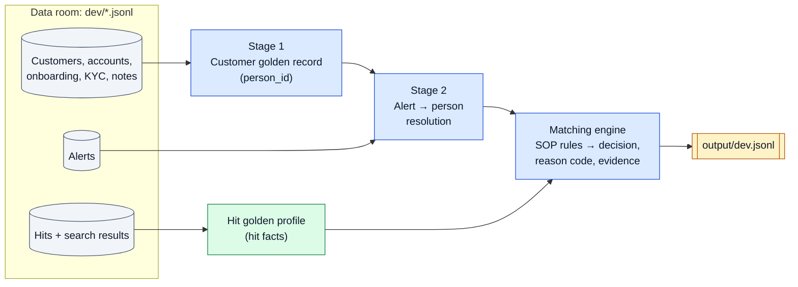

# Sanctions Screening: "Is my customer sanctioned?"

A deterministic, fully traceable system that decides, for every screening **hit**, whether the listed profile is really the bank's customer.

> Built for the Fin Crime Hackathon (sanctions name screening track).

## The problem

A payments company screens every customer against sanctions, PEP, enforcement and adverse-media lists. When a name looks similar, an **alert** is raised. Each alert has one or more **hits**: list profiles that might be the customer. For every hit we must decide:

| Decision | Meaning |
|---|---|
| `DIFFERENT_ENTITY` | The evidence shows the hit is someone else. The hit is cleared. |
| `SAME_ENTITY` | The evidence shows the hit is the customer. It goes to compliance. |
| `REVIEW` | The evidence can't settle it. A person looks at it. |

Each decision comes with one reason code, the IDs of the records it rests on, and the customer record it resolved. Clearing a hit that really is the customer is the worst possible mistake, so **when in doubt, REVIEW**.

The hard part is that the customer's identity is spread over five systems that share no common key, and the hit's facts can be hidden in free text.

## Architecture

Three stages. Each one is deterministic and emits a record-level trace, so every final decision can be replayed step by step.



| Stage | What it does | Status |
|---|---|---|
| **1. Customer golden record** | Normalises customer data, groups records that are the same person into a `person_id`, and picks each fact (legal name, date of birth, countries, …) with its source record ID. | 📐 Designed: [docs/stage1-customer-golden-record.md](docs/stage1-customer-golden-record.md) |
| **2. Alert → person resolution** | Follows the alert's link (account, login, email) or searches by the screened details to find the person(s) behind each alert. | Next |
| **Hit profile + matching** | Collects each hit's facts (names, aliases, birth dates, countries, dated reports), then applies the screening SOP to produce the decision. | Planned |

### Design principles

- **Deterministic first.** Joins, filters and regex. No heuristics, no scores, no randomness. The same input always gives byte-identical output.
- **Traceable.** Every fact carries the ID of the record it came from, and every decision cites the records it rests on.
- **Verified beats declared.** An approved identity check outranks what's typed on the customer record.
- **Unknown stays unknown.** Missing or unreadable data is never guessed. It is flagged, and it pushes towards `REVIEW`.
- **Python standard library only.** An LLM is an optional, switched-off fallback for free text that regex can't read (not needed on the dev set).

## Repository layout (planned)

```
.
├── README.md                  ← you are here
├── docs/
│   └── stage1-customer-golden-record.md
├── system/
│   ├── README.md              ← how to run the system
│   └── run                    ← entry point: reads a data folder, writes decisions
├── tools/repro/               ← reproducibility report (repro.json)
└── output/
    └── dev.jsonl              ← our decisions for the development set
```

## Reproducibility report

`tools/repro` compares repeated runs and writes one `repro.json` for the static UI. Full field guide, schema, and the gaps against the design: [tools/repro/README.md](tools/repro/README.md). Schema: [tools/repro/repro.schema.json](tools/repro/repro.schema.json). A synthetic five-run sample (no real customers) is [tools/repro/repro.example.json](tools/repro/repro.example.json).

```bash
python -m unittest discover -s tools/repro/tests -v

python -m tools.repro \
  --outputs run1.jsonl run2.jsonl run3.jsonl run4.jsonl run5.jsonl \
  --traces trace1.jsonl trace2.jsonl trace3.jsonl trace4.jsonl trace5.jsonl \
  --llm-off-output llm-off.jsonl \
  --out repro.json

python -m tools.repro --run --data /path/to/data --n 5 \
  --work-dir repro-work --capture-traces --llm-off --out repro.json
```

File order is run order. Traces are optional. `--capture-traces` sets `TRACE_PATH` on each `system/run`. The report is deterministic: sorted keys, hits sorted by `hit_id`, and no timestamp except `meta.generated_at`.

| Field | Meaning |
|---|---|
| `summary.judges_metric` | Share of hits with the same decision and reason code in every run. A hit missing from a run does not count. |
| `summary.decision_flip_hits` | Decision not the same across the runs that contain the hit. |
| `summary.code_only_flip_hits` | Decision agrees, reason code does not. |
| `summary.strict_change_hits` | Evidence, `customer_record_id`, canonical facts, or canonical steps changed. The judges' metric can still be 1. |
| `summary.missing_hits` | Hits absent from at least one run. |
| `summary.decision_counts_per_run` | `DIFFERENT_ENTITY` / `SAME_ENTITY` / `REVIEW` counts for each run. |
| `summary.flips_by_llm_used` | Those flips split by the trace badge `llm_used`, or `unknown` when there is no badge. |
| `config_check` | Per-run git SHA, `rules_version`, policy / name-variant / prompt / input hashes, model, served provider, Python version. Each `all_identical` flag is null when only outputs were given. |
| `llm_sensitivity` | Hits whose decision or code differs from the LLM-on modal result. Null if no LLM-off file was passed. |
| `hits[].per_run` | The five-dot strip: `[decision, reason_code]`, or null. |
| `hits[].flip_type` | `none`, `decision`, `code`, `evidence` (evidence ids or customer record), or `other` (missing hit, facts, steps). |
| `hits[].first_divergent_step` | First step in the stable rule order where traced runs diverge, plus that step's values. |
| `heatmap` | Decisions (and reason codes) with one row per hit and one column per run. |
| `ui.filters` | Hit ids for flipped-only, LLM-sensitive, thin clearances, and thin or borderline plus LLM. |

Canonical facts are the attribute, the normalised value, and the source id. Quote text and `llm_calls` are not compared, and reason sentences are not written into the report. Do not commit a `repro.json` built from real traces.

## Data and secrets

- The hackathon data (`dev/` folder) is **participant-only** and is **never committed** to this repository. Point `system/run` at your local copy.
- API keys (e.g. for the optional LLM fallback) are read from environment variables and are **never committed**.
- All examples in the docs use **invented values**.
