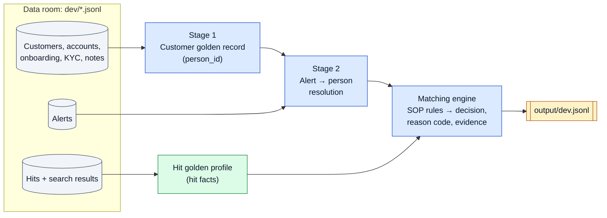

# Sanctions Screening: "Is my customer sanctioned?"

A deterministic, fully traceable system that decides, for every screening **hit**, whether the listed profile is really the bank's customer.

> Built for the Fin Crime Hackathon (sanctions name screening track).

## The problem

A payments company screens every customer against sanctions, PEP, enforcement and adverse-media lists. When a name looks similar, an **alert** is raised. Each alert has one or more **hits**: list profiles that might be the customer. For every hit we must decide:

| Decision | Meaning |
|---|---|
| `DIFFERENT_ENTITY` | The evidence shows the hit is someone else. The hit is cleared. |
| `SAME_ENTITY` | The evidence shows the hit is the customer. It goes to compliance. |
| `REVIEW` | The evidence can't settle it. A person looks at it. |

Each decision comes with one reason code, the IDs of the records it rests on, and the customer record it resolved. Clearing a hit that really is the customer is the worst possible mistake, so **when in doubt, REVIEW**.

The hard part is that the customer's identity is spread over five systems that share no common key, and the hit's facts can be hidden in free text.

## Architecture

Three stages. Each one is deterministic and emits a record-level trace, so every final decision can be replayed step by step.



| Stage | What it does | Status |
|---|---|---|
| **1. Customer golden record** | Normalises customer data, groups records that are the same person into a `person_id`, and picks each fact (legal name, date of birth, countries, …) with its source record ID. | 📐 Designed: [docs/stage1-customer-golden-record.md](docs/stage1-customer-golden-record.md) |
| **2. Alert → person resolution** | Follows the alert's link (account, login, email) or searches by the screened details to find the person(s) behind each alert. | Next |
| **Hit profile + matching** | Collects each hit's facts (names, aliases, birth dates, countries, dated reports), then applies the screening SOP to produce the decision. | Planned |

### Design principles

- **Deterministic first.** Joins, filters and regex. No heuristics, no scores, no randomness. The same input always gives byte-identical output.
- **Traceable.** Every fact carries the ID of the record it came from, and every decision cites the records it rests on.
- **Verified beats declared.** An approved identity check outranks what's typed on the customer record.
- **Unknown stays unknown.** Missing or unreadable data is never guessed. It is flagged, and it pushes towards `REVIEW`.
- **Python standard library only.** An LLM is an optional, switched-off fallback for free text that regex can't read (not needed on the dev set).

## Repository layout (planned)

```
.
├── README.md                  ← you are here
├── docs/
│   └── stage1-customer-golden-record.md
├── system/
│   ├── README.md              ← how to run the system
│   └── run                    ← entry point: reads a data folder, writes decisions
└── output/
    └── dev.jsonl              ← our decisions for the development set
```

## Data and secrets

- The hackathon data (`dev/` folder) is **participant-only** and is **never committed** to this repository. Point `system/run` at your local copy.
- API keys (e.g. for the optional LLM fallback) are read from environment variables and are **never committed**.
- All examples in the docs use **invented values**.
