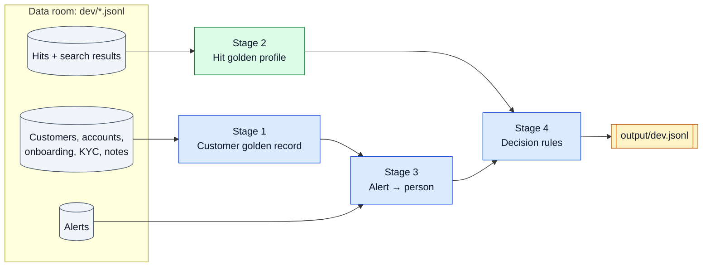

# Sanctions Screening: "Is my customer sanctioned?"

A deterministic, fully traceable system that decides, for every screening **hit**, whether the listed profile is really the bank's customer.

> Built for the Fin Crime Hackathon (sanctions name screening track).

## The problem

A payments company screens every customer against sanctions, PEP, enforcement and adverse-media lists. When a name looks similar, an **alert** is raised. Each alert has one or more **hits**: list profiles that might be the customer. For every hit we must decide:

| Decision | Meaning |
|---|---|
| `DIFFERENT_ENTITY` | The evidence shows the hit is someone else. The hit is cleared. |
| `SAME_ENTITY` | The evidence shows the hit is the customer. It goes to compliance. |
| `REVIEW` | The evidence can't settle it. A person looks at it. |

Each decision comes with one reason code, the IDs of the records it rests on, and the customer record it resolved. Clearing a hit that really is the customer is the worst possible mistake, so **when in doubt, REVIEW**.

The hard part is that the customer's identity is spread over five systems that share no common key, and the hit's facts can be hidden in free text.

## Open the reviewer UI

The reviewer UI is a page in your browser. It shows each hit, the alert it belongs to, and whether repeated runs stayed the same. It reads files on your computer. It never makes a network call.

### Quickest: the built page

The built page is already in the repository (`ui/dist/`), so you do not install anything.

1. Clone this repository.
2. Open `ui/dist/index.html`. Double-clicking the file opens it in your browser.
3. Add `?sample=1` to the end of the address and press Enter. The page reads that query string and shows synthetic sample data (invented customers).

On the Overview screen, **Load sample** loads that same sample.

### Dev mode

With Node.js installed, from the repository root:

```bash
cd ui && npm ci && npm run dev -- --host 127.0.0.1 --port 5173 --strictPort
```

Then open http://127.0.0.1:5173/?sample=1.

### Demo links

Append one of these to either address above (`ui/dist/index.html` or `http://127.0.0.1:5173/`).

| What you see | Append |
|---|---|
| Our own dev run (dev server only: `output/dev.jsonl`, or `working/trace.jsonl` if present, plus `dev/alerts.jsonl` if present) | `?run=local` |
| Overview, full sample | `?sample=1` |
| Full sample, reproducibility report with a flipped run | `?sample=1&repro=flipped` |
| Sample without the alert list, so clears show as Not verified | `?sample=summaries` |
| Analyst queue | `?sample=1&screen=queue` |
| Audit, REVIEW only | `?sample=1&screen=audit&verdict=REVIEW` |
| SAME_ENTITY hit `H-SYN003` on alert `A-SYN002` | `?sample=1&alert=A-SYN002&hit=H-SYN003` |
| REVIEW hit `H-SYN006` on alert `A-SYN003` | `?sample=1&alert=A-SYN003&hit=H-SYN006` |

`H-SYN003` is `SAME_ENTITY` and `H-SYN006` is `REVIEW` in `ui/fixtures`.

### Load real pipeline output

On Overview, the three **Open …** buttons each open a file picker. The page reads the file you choose in the browser. It does not upload the file.

- **Open trace…** reads a trace file: one JSON object per line, one hit per line (`trace.jsonl`).
- **Open alerts…** reads the alert list (`alerts.jsonl`: `alert_id` and `hit_ids`). That file is what lets an alert show as Cleared. Choose **Open alerts…** again for the pipeline alert summaries (`alerts.trace.jsonl`, lines with `alert_status`). The page uses those only to cross-check its own totals. It tells the two files apart from their contents.
- **Open repro…** reads a `repro.json` from `tools/repro`.

Sample data is compiled into the page, and the built page blocks network connections. Real traces, real alert files, and a `repro.json` built from real traces hold customer facts and must not be committed. Git ignores `output/trace.jsonl`, other `trace.jsonl` and `alerts*.jsonl` files, and `repro-work/`. The synthetic `ui/fixtures/*.sample.*` files are the exception.

Field-by-field developer notes: [ui/README.md](ui/README.md).

## Architecture

Four deterministic stages in `system/`. Stages 1–3 build both sides of the comparison; Stage 4 applies the SOP and writes one line per hit. `system/run` runs all four. How it decides, cites evidence and stays reproducible: [system/README.md](system/README.md).



| Stage | What it does | Status |
|---|---|---|
| **1. Customer golden record** | Normalises customer data, groups records that are the same person into a `person_id`, and picks each fact (legal name, date of birth, countries) with its source record ID. | Built. [docs/stage1-customer-golden-record.md](docs/stage1-customer-golden-record.md) |
| **2. Hit golden profile** | Collects each hit's names, countries, birth-date candidates, death date and earliest dated report. | Built. [docs/stage2-hit-golden-profile.md](docs/stage2-hit-golden-profile.md) |
| **3. Alert → person resolution** | Follows the alert's link (account, login, email) or searches by the screened details to find the person or people behind each alert. | Built. [docs/stage3-alert-resolution.md](docs/stage3-alert-resolution.md) |
| **4. Decision rules** | Compares the person with the hit and writes `DIFFERENT_ENTITY`, `SAME_ENTITY` or `REVIEW`, with a reason code and evidence. | Built. [system/README.md](system/README.md) · design: [docs/stage4-notes.md](docs/stage4-notes.md) |

### Dev run

One `system/run` on the development folder, LLM off. Counts are from that run. Times are that machine only.

| | |
|---|---|
| Stage 1 | 72,265 records → 72,142 persons (123 multi-record). Notes flagged 4 of 31,895 (`name_ambiguous` 3, `note_annotation` 1). 23.629s |
| Stage 2 | 819 hits (702 individuals, 117 companies). DOB buckets: `dobs` only 146, `dobs` and note 6, note only 48, search 55, unknown 447. Note birth statements 54. Deceased 6, of which 2 undated. Dated reports 640 lines on 215 hits. Practice 41/41 individuals and 9/9 companies. LLM calls 0. 0.17s |
| Stage 3 | 440 alerts: 413 `resolved_single`, 27 `ambiguous`, 0 `not_found`. Joint accounts 58/58 resolved. `resolution_clean` 307. Practice labels 50/50. 8.294s |

### Design principles

- **Deterministic first.** Joins, filters and regex. No heuristics, no scores, no randomness. The same input always gives byte-identical output.
- **Traceable.** Every fact carries the ID of the record it came from, and every decision cites the records it rests on.
- **Verified beats declared.** An approved identity check outranks what's typed on the customer record.
- **Unknown stays unknown.** Missing or unreadable data is never guessed. It is flagged, and it pushes towards `REVIEW`.
- **Python standard library only.** An LLM is an optional, switched-off fallback for free text that regex can't read (not needed on the dev set).

## Repository layout

```
.
├── README.md
├── BRIEF.md  POLICY.md        ← the organisers' brief and the bank's SOP
├── docs/                      ← one doc per stage + shared/pipeline (index: docs/README.md)
├── system/
│   ├── run                    ← entry point: stages 1–4, one decision per hit
│   ├── pipeline.py
│   ├── stage1/  stage2/  stage3/
│   ├── shared/                ← data reader, name agreement, LLM client, time budget
│   └── tests/
├── tools/repro/               ← reproducibility report (repro.json)
├── ui/                        ← read-only reviewer UI (local files only)
├── validate.py                ← the organisers' output checker
└── output/dev.jsonl           ← our decisions for the development set
```

## Documentation

| Doc | What's in it |
|---|---|
| [docs/README.md](docs/README.md) | Index and conventions |
| [Stage 1](docs/stage1-customer-golden-record.md) · [Stage 2](docs/stage2-hit-golden-profile.md) · [Stage 3](docs/stage3-alert-resolution.md) | How each stage works, its code map, known gaps and planned refactor |
| [Stage 4 notes](docs/stage4-notes.md) | Decision-rule design (the built system is described in system/README.md) |
| [Shared code and pipeline](docs/shared-and-pipeline.md) | `system/run`, shared modules, LLM client, tests, cross-stage refactor plan |
| [Explainability and reproducibility](docs/explainability-and-reproducibility.md) | Per-hit trace, reasons, citations, determinism |

Run the tests:

```bash
cd system && python3 -m unittest discover -s tests
```

## Reproducibility report

`tools/repro` compares repeated runs and writes one `repro.json` for the static UI. Full field guide, schema, and the gaps against the design: [tools/repro/README.md](tools/repro/README.md). Schema: [tools/repro/repro.schema.json](tools/repro/repro.schema.json). A synthetic five-run sample (no real customers) is [tools/repro/repro.example.json](tools/repro/repro.example.json).

```bash
python -m unittest discover -s tools/repro/tests -v

python -m tools.repro \
  --outputs run1.jsonl run2.jsonl run3.jsonl run4.jsonl run5.jsonl \
  --traces trace1.jsonl trace2.jsonl trace3.jsonl trace4.jsonl trace5.jsonl \
  --llm-off-output llm-off.jsonl \
  --out repro.json

python -m tools.repro --run --data /path/to/data --n 5 \
  --work-dir repro-work --capture-traces --llm-off --out repro.json
```

File order is run order. Traces are optional. `--capture-traces` sets `TRACE_PATH` on each `system/run`. The report is deterministic: sorted keys, hits sorted by `hit_id`, and no timestamp except `meta.generated_at`.

| Field | Meaning |
|---|---|
| `summary.judges_metric` | Share of hits with the same decision and reason code in every run. A hit missing from a run does not count. |
| `summary.decision_flip_hits` | Decision not the same across the runs that contain the hit. |
| `summary.code_only_flip_hits` | Decision agrees, reason code does not. |
| `summary.strict_change_hits` | Evidence, `customer_record_id`, canonical facts, or canonical steps changed. The judges' metric can still be 1. |
| `summary.missing_hits` | Hits absent from at least one run. |
| `summary.decision_counts_per_run` | `DIFFERENT_ENTITY` / `SAME_ENTITY` / `REVIEW` counts for each run. |
| `summary.flips_by_llm_used` | Those flips split by the trace badge `llm_used`, or `unknown` when there is no badge. |
| `config_check` | Per-run git SHA, `rules_version`, policy / name-variant / prompt / input hashes, model, served provider, Python version. Each `all_identical` flag is null when only outputs were given. |
| `llm_sensitivity` | Hits whose decision or code differs from the LLM-on modal result. Null if no LLM-off file was passed. |
| `hits[].per_run` | The five-dot strip: `[decision, reason_code]`, or null. |
| `hits[].flip_type` | `none`, `decision`, `code`, `evidence` (evidence ids or customer record), or `other` (missing hit, facts, steps). |
| `hits[].first_divergent_step` | First step in the stable rule order where traced runs diverge, plus that step's values. |
| `heatmap` | Decisions (and reason codes) with one row per hit and one column per run. |
| `ui.filters` | Hit ids for flipped-only, LLM-sensitive, thin clearances, and thin or borderline plus LLM. |

Canonical facts are the attribute, the normalised value, and the source id. Quote text and `llm_calls` are not compared, and reason sentences are not written into the report. Do not commit a `repro.json` built from real traces.

## Data and secrets

- The hackathon data (`dev/` folder) is **participant-only** and is **never committed** to this repository. Point `system/run` at your local copy.
- API keys (e.g. for the optional LLM fallback) are read from environment variables and are **never committed**.
- All examples in the docs use **invented values**.
