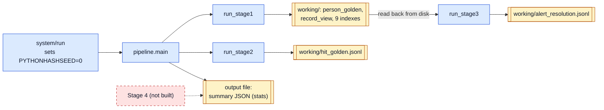

# Shared code, the pipeline and tooling

> This doc covers everything that isn't a single stage: the entry point (`system/run`), the shared modules every stage uses, the optional LLM client, the reproducibility tool and the tests. Stage docs: [1](stage1-customer-golden-record.md) · [2](stage2-hit-golden-profile.md) · [3](stage3-alert-resolution.md) · [4](stage4-notes.md).

| | |
|---|---|
| **Status** | ✅ Pipeline runs Stages 1–3. ⚠️ It writes a **summary JSON**, not one decision per hit. That changes when Stage 4 lands. |
| **Planned refactor** | [§6](#6-refactor-plan-to-be-done). Not started. |

---

## 1. How a run works today



- `system/run <data folder> <output file>` makes sure `PYTHONHASHSEED=0` is set (it re-launches itself once if not), then calls `pipeline.main`.
- `pipeline.py` runs Stage 1, Stage 2 and Stage 3 in order. Each stage writes its files into the cache folder (`working/`, or `$SANCTIONS_CACHE`). Stage 3 reads Stage 1's files back from that folder.
- The output file currently gets a stats summary (record, person, hit and alert counts, and the practice-label check). **This fails `validate.py`.** The output file must hold one line per hit once Stage 4 exists.

## 2. Shared modules (`system/shared/`)

| File | What it does | Used by |
|---|---|---|
| `names.py` | `agree_parts`: the SOP name-agreement rule. Tries every one-to-one pairing of parts (not greedy), handles written-together/apart joins on both sides, fixed tie-break, symmetric since PR #10 | `NameTools.names_agree` in Stage 1, so all stages |
| `contracts.py` | Checks Stage 4 must call before clearing: `name_mismatch_verified_allowed`, `location_mismatch_allowed`, `dob_mismatch_allowed`; `customer_record_id_for_output` (never a `P-` ID); `hit_field_evidence` (`H-XXXXXX#field`) | Stage 4 (not built yet) |
| `llm_client.py` | The optional OpenRouter client (§3) | `stage1/llm.py`, `stage2/llm.py` |

The rest of the shared toolkit (text folding, date parsing, phone/email/document normalisers, edit distance, `NameTools`, the country table) **lives in `system/stage1/`** today, and Stages 2 and 3 import it from there. Moving it here is refactor step R1.1 in the Stage 1 doc.

## 3. LLM client

`system/shared/llm_client.py`, standard library only (`urllib`). **Off by default**; regex covers the dev set.

| Setting | Value on main |
|---|---|
| Switches | `SANCTIONS_LLM=0` turns every stage off. `USE_LLM_NOTES=1` (Stage 1) and `USE_LLM_HITS=1` (Stage 2) turn each one on |
| Key | `OPENROUTER_API_KEY` from the environment, never committed |
| Model | `google/gemma-4-31b-it:free`, pinned. Any slug not ending in `:free` is refused with no network call |
| Provider | `Google AI Studio` only, `allow_fallbacks: false` |
| Sampling | temperature 0, fixed seed, strict JSON schema |
| Agreement | 3 identical calls required (`VOTES = 3`), else UNKNOWN |
| Validation | every string in the answer must appear verbatim in the source text |
| Budget | one shared client per run: 48 calls per run, 12 per extraction, items visited in sorted ID order, 20-minute backstop. HTTP 429 gets a short bounded retry |
| Failure | timeout, bad JSON, quote miss, disagreement, budget used up → UNKNOWN, which leads to REVIEW |
| Cache | none |
| Clearing | every LLM fact carries `method: "llm"` and `may_solely_support_different_entity: false`. Team rule: an LLM-read fact never contributes to a clear (Stage 4 enforces this) |

**Open questions (not decided):**

- **Free endpoints are heavily rate-limited.** During the judges' five runs, 429s that outlast the retry make some runs see a fact and others not, which is a reproducibility risk. Measure first: run 5 times on dev with the LLM on and count rate-limit UNKNOWNs and hits whose decision changes between LLM on and off. If that set isn't near zero, consider a pinned paid model. The brief also now mentions a Grok key, still read from `OPENROUTER_API_KEY`. Stick with OpenRouter unless the organisers confirm otherwise.
- **Are 3 votes needed?** Measure per-fact agreement over 15 calls (5 runs × 3) before keeping them. If the model is deterministic, the votes only add cost and rate-limit pressure.
- **`data_collection: deny`** is not sent in requests yet.

## 4. Reproducibility tool (`tools/repro/`)

Compares repeated runs and writes one `repro.json` for the UI: the judges' metric (same decision and reason code in all runs), decision and code flips, strict changes, LLM sensitivity, config hashes, and a per-hit five-run strip. Field guide in [tools/repro/README.md](../tools/repro/README.md) and the root README. It needs per-hit output and traces, so it becomes useful once Stage 4 writes them. The design behind it is in [explainability-and-reproducibility.md](explainability-and-reproducibility.md).

## 5. Tests

```bash
cd system && python3 -m unittest discover -s tests      # 122 tests, 5 skip without dev/
python3 -m unittest discover -s tools/repro/tests        # from the repo root
```

All fixtures are synthetic. The `test_repro.py` and `test_stage2_repro.py` suites run against a local `dev/` folder and skip when it is absent.

---

## 6. Refactor plan (to be done)

Cross-stage steps. Stage-specific steps are in each stage doc (R1.x, R2.x, R3.x). Rules for every step: behaviour unchanged, artefacts byte-identical on the dev folder (diff before and after), all tests green, **no edits to Stage 4 code or `docs/stage4-notes.md`** without the Stage 4 owner. When a step lands, change its status to **Done** and add the commit.

| ID | Change | Why | Status |
|---|---|---|---|
| RS.1 | `system/shared/` becomes the one home for common helpers: `text.py`, `normalise.py` (dates, ids, edit distance), `names.py` (`NameTools` + `agree_parts`), `countries.py`, `io.py`, `llm_client.py`, `contracts.py`. Detailed in Stage 1 R1.1 | Every stage imports from `shared`, never from another stage | To do |
| RS.2 | One JSON/JSONL reader and writer in `shared/io.py`, replacing `DataStore.read_jsonl`, `stage3/cli._read_json(l)`, the readers in `stage1_adapter.py`, and the writers in `stage1/build.py` | Four copies of the same loop | To do |
| RS.3 | One LLM switch helper in `shared/llm_client.py` (`llm_enabled("notes" or "hits")`) and one quote check. `stage1/llm.py` and `stage2/llm.py` keep only their prompt, schema and slot logic | The switch logic and quote checks are duplicated | To do |
| RS.4 | One entry point. `system/run` → `pipeline.main`, with an optional `--stage N` for debugging. Remove the per-stage `cli.py` and `__main__.py` once nothing imports them (`test_stage3.py` uses `stage3.cli` today, so update it) | Three CLIs plus the pipeline, for one program | To do |
| RS.5 | Move evaluation out of the pipeline into `tools/eval/`: Stage 2 `practice.py`, Stage 3 `cli._practice` and `recall.py`, and the practice numbers in the pipeline summary. `system/run` then only produces answers | Keeps the judged program small and focused | To do |
| RS.6 | Stages hand data to each other **in memory**. Cache files are written only when asked (`SANCTIONS_CACHE` set, or a `--keep-cache` flag), for debugging and the UI | Removes the disk round trip and the 260-line adapter's file path | To do |
| RS.7 | The run summary goes to stderr or the trace run header, never the output file, which is kept for Stage 4's per-hit lines. **Agree with the Stage 4 owner first** | The output file must pass `validate.py` | To do |
| RS.8 | Docs: one doc per stage plus this one. Review notes and the changelog folded in and deleted | Done in this pass | **Done** |
