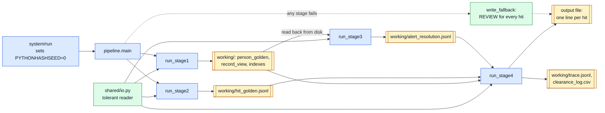

# Shared code, the pipeline and tooling

> This doc covers everything that isn't a single stage: the entry point (`system/run`), the shared modules every stage uses, the optional LLM client, the reproducibility tool and the tests. Stage docs: [1](stage1-customer-golden-record.md) · [2](stage2-hit-golden-profile.md) · [3](stage3-alert-resolution.md) · [4](stage4-notes.md).

| | |
|---|---|
| **Status** | ✅ `system/run` runs Stages 1–4 and writes one decision per hit. Stats go to `run_summary.json` in the cache. |
| **Planned refactor** | [§6](#6-refactor-plan-to-be-done) |

---

## 1. How a run works today



- `system/run <data folder> <output file>` makes sure `PYTHONHASHSEED=0` is set (re-launching itself once if not), then calls `pipeline.main`.
- Every stage reads the data folder through `shared/io.py` (§2), so all stages see the same cleaned rows.
- Each stage writes its files into the cache folder (`working/`, or `$SANCTIONS_CACHE`). Stage 3 reads Stage 1's files back from there, and Stage 4 reads all three.
- **Failure handling.** A note, hit or alert that makes a stage raise is skipped (Stage 1 treats the note as unread, which blocks clears for that person); Stage 4 then leaves the affected hits in `REVIEW`. If a whole stage still fails, `write_fallback` writes `REVIEW / INSUFFICIENT_DATA` for every hit, so the run never ends with no output. The run summary is written after the output and cannot break a finished run.

## 2. Shared modules (`system/shared/`)

| File | What it does | Used by |
|---|---|---|
| `io.py` | Reads the data folder for every stage. `customers`, `alerts`, `hits` are required; other tables read as empty when missing. Skips lines that aren't JSON objects. Maps entity-type synonyms (`individual`, `Person`, `Organisation`, …) to `Individual` / `Company` and turns single-string hit list fields into lists. Also the cache writers | all stages |
| `time_budget.py` | The 25-minute run deadline and the shared 20-minute LLM clock | pipeline, LLM client |
| `names.py` | `agree_parts`: the SOP name-agreement rule. Tries every one-to-one pairing of parts (not greedy), handles written-together/apart joins on both sides, fixed tie-break, symmetric since PR #10 | `NameTools.names_agree` in Stage 1, so all stages |
| `contracts.py` | Helper checks for the Stage 1 contracts (`name_mismatch_verified_allowed`, …). Stage 4's gate reads the same flags directly (`stage4/gate.py`), so these helpers are only used by tests today | tests |
| `llm_client.py` | The optional OpenRouter client (§3) | `stage1/llm.py`, `stage2/llm.py` |

The rest of the shared toolkit (text folding, date parsing, phone/email/document normalisers, edit distance, `NameTools`, the country table) **lives in `system/stage1/`** today, and Stages 2 and 3 import it from there. Moving it here is refactor step R1.1 in the Stage 1 doc.

## 3. LLM client

`system/shared/llm_client.py`, standard library only (`urllib`). **Off by default**; regex covers the dev set.

| Setting | Value on main |
|---|---|
| Switches | `SANCTIONS_LLM=0` turns every stage off. `USE_LLM_NOTES=1` (Stage 1) and `USE_LLM_HITS=1` (Stage 2) turn each one on. Stage 4 has no model step (the planned veto was never wired to a model and was removed) |
| Key | `OPENROUTER_API_KEY` from the environment, never committed |
| Model | `google/gemma-4-31b-it:free`, pinned. Any slug not ending in `:free` is refused with no network call |
| Provider | `Google AI Studio` only, `allow_fallbacks: false` |
| Sampling | temperature 0, fixed seed, strict JSON schema |
| Agreement | 3 identical calls required (`VOTES = 3`), else UNKNOWN |
| Validation | every string in the answer must appear verbatim in the source text |
| Budget | one shared client per run: 48 calls per run, 12 per extraction, items visited in sorted ID order, 20-minute backstop. HTTP 429 gets a short bounded retry |
| Failure | timeout, bad JSON, quote miss, disagreement, budget used up → UNKNOWN, which leads to REVIEW |
| Cache | none |
| Clearing | every LLM fact carries `method: "llm"` and `may_solely_support_different_entity: false`. Team rule: an LLM-read fact never contributes to a clear (Stage 4 enforces this) |

**Open questions (not decided):**

- **Free endpoints are heavily rate-limited.** During the judges' five runs, 429s that outlast the retry make some runs see a fact and others not, which is a reproducibility risk. Measure first: run 5 times on dev with the LLM on and count rate-limit UNKNOWNs and hits whose decision changes between LLM on and off. If that set isn't near zero, consider a pinned paid model. The brief also now mentions a Grok key, still read from `OPENROUTER_API_KEY`. Stick with OpenRouter unless the organisers confirm otherwise.
- **Are 3 votes needed?** Measure per-fact agreement over 15 calls (5 runs × 3) before keeping them. If the model is deterministic, the votes only add cost and rate-limit pressure.
- **`data_collection: deny`** is not sent in requests yet.

## 4. Reproducibility tool (`tools/repro/`)

Compares repeated runs and writes one `repro.json` for the UI: the judges' metric (same decision and reason code in all runs), decision and code flips, strict changes, LLM sensitivity, config hashes, and a per-hit five-run strip. Field guide in [tools/repro/README.md](../tools/repro/README.md) and the root README.

`tools/eval/` grades an output file against the practice labels (cost-based score, false clears, reason codes, evidence recall and precision). See [tools/eval/README.md](../tools/eval/README.md). The design behind it is in [explainability-and-reproducibility.md](explainability-and-reproducibility.md).

## 5. Tests

```bash
cd system && python3 -m unittest discover -s tests      # 5 skip without dev/
python3 -m unittest discover -s tools/repro/tests        # from the repo root
python3 -m unittest discover -s tools/eval/tests
```

All fixtures are synthetic. The `test_repro.py` and `test_stage2_repro.py` suites run against a local `dev/` folder and skip when it is absent. `test_resilience.py` covers missing files, malformed rows and the fallback.

---

## 6. Refactor plan (to be done)

Cross-stage steps. Stage-specific steps are in each stage doc (R1.x, R2.x, R3.x). Rules for every step: behaviour unchanged, artefacts byte-identical on the dev folder (diff before and after), all tests green, **no edits to Stage 4 code or `docs/stage4-notes.md`** without the Stage 4 owner. When a step lands, change its status to **Done** and add the commit.

| ID | Change | Why | Status |
|---|---|---|---|
| RS.1 | `system/shared/` becomes the one home for common helpers: move `text`, dates/ids/edit distance, `NameTools` and the country table out of `stage1/`. Detailed in Stage 1 R1.1 | Every stage imports from `shared`, never from another stage | To do. Pure moves, no score impact, and they touch every stage's imports. Best done when no other agent is editing `system/` |
| RS.2 | One JSON/JSONL reader and writer (`shared/io.py`) | Four copies of the same loop | **Done** (`881953b`) |
| RS.3 | One LLM switch helper and one quote check in `shared/llm_client.py` | Duplicated switch logic and quote checks | To do |
| RS.4 | One entry point; drop per-stage `cli.py` / `__main__.py` once nothing imports them | Four CLIs plus the pipeline | To do |
| RS.5 | One evaluation tool. Practice-label scoring lived in five places. `validate.py` (organisers') and `tools/eval/` stay; the Stage 2, 3 and 4 copies moved into `tools/eval/stages.py` (`--cache working` checks hit profiles and alert resolution) and `system/run` no longer reads the labels | The judged program only produces answers | **Done** |
| RS.6 | Stages pass data in memory; cache files only on request | Removes the disk round trip and the adapter's file path | To do |
| RS.7 | Run summary out of the output file | The output file must pass `validate.py` | **Done** (Stage 4 PR: `run_summary.json` in the cache) |
| RS.8 | One doc per stage plus this one | | **Done** |
| RS.9 | Tolerate malformed unseen data: optional files, bad lines, entity-type synonyms, list fields, per-item failures, whole-run fallback | A crash means no output: every hit counts as `REVIEW` and the run scores 0 | **Done** (`881953b`, `6050a6d`) |
| RS.10 | Remove dead code: Stage 4 veto (never wired to a model), Stage 3 name wrapper, Stage 4 reverse name call | | **Done** (`3a18af6`) |

**How refactors are checked.** `system/tests` plus a synthetic end-to-end run on three generated data folders (all reason codes are exercised). The output file, the trace and every cache file must be byte-identical before and after. Steps that intentionally change behaviour say so in their commit, and `output/dev.jsonl` must then be regenerated on the real data room.
