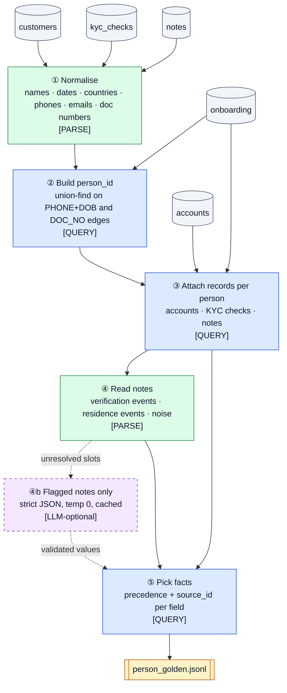
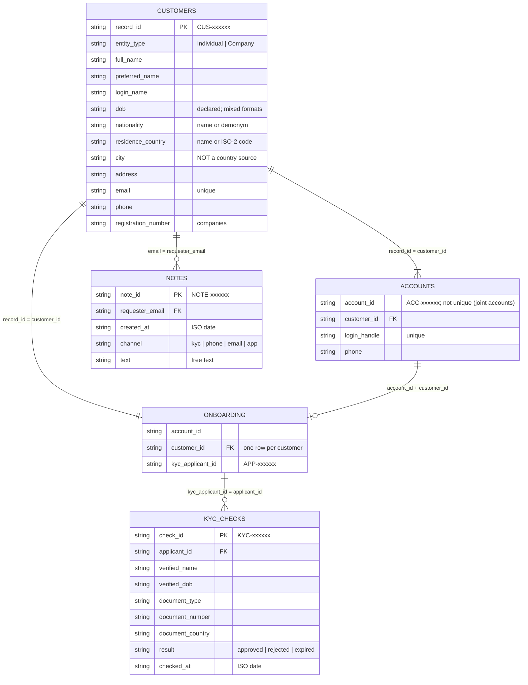
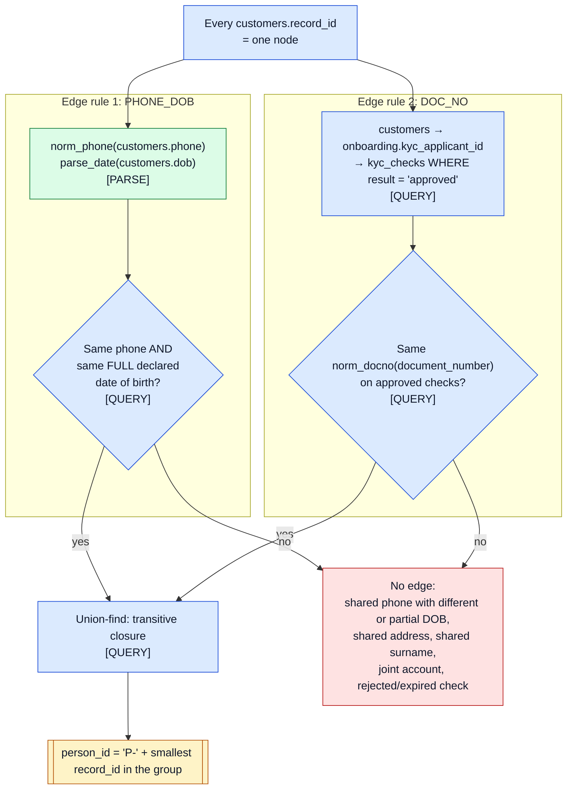
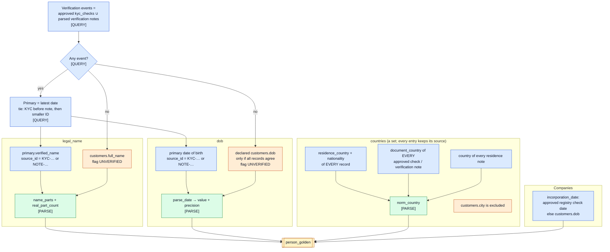

# Stage 1: Customer Golden Record (`person_id`)

> **Goal:** turn the bank's scattered customer data into one clean, traceable record per real person. Every fact carries the ID of the record it came from.
>
> **Later stages:** Stage 2 builds the hit golden profile. Stage 3 resolves each alert to a person in this table. Stage 4 decides the hit. This document is Stage 1 only.

---

## 1. Why this stage exists

Before we can decide whether a watch-list hit *is* our customer, we need to know **who our customer actually is**. That's harder than it sounds:

- **The customer is spread over five systems with no shared key.** The system of record, accounts, onboarding, the KYC provider and the support tool each hold part of the picture. They link through different columns (customer ID, account ID, applicant ID, email).
- **One person can have several customer records.** Records that share a phone number *and* the same full date of birth, or share a document number on an approved identity check, belong to the same person. A shared phone or address alone does **not** count: family members often share them.
- **Verified beats declared.** What a customer typed at sign-up (name, date of birth) can be a nickname, a typo or plain wrong. The most recent **approved** identity check is the most reliable source. Rejected or expired checks are not evidence. In the development data they almost always disagree with the approved check, so using them would be a trap.
- **Unknown stays unknown.** If a fact is missing or can't be read, we record that it's missing. We never guess. Downstream, missing evidence pushes a hit towards `REVIEW`, never towards clearing it.

### Design constraints

| Constraint | How Stage 1 meets it |
|---|---|
| **Deterministic** | Pure joins, filters and regex. Stable IDs. Sorted outputs, so two runs are byte-identical. |
| **Traceable** | Every fact is stored as `{value, precision, source_id}`. Every merge of two records stores the rule and the evidence behind it. |
| **Python standard library only** | No pandas, no external fuzzy-matching libraries. Edit distance, date parsing and the country tables are implemented in-repo. |
| **No LLM needed** | Free-text notes are read with regex and fixed word lists. Measured on the development set: **100%** coverage for check date, date of birth and document country in verification notes; **≥99.9%** for the verified name; **100%** for residence-history notes. An LLM fallback exists only as an optional, switched-off safety net (see §6). |

Every step below is labelled:

- 🟦 **[QUERY]**: a deterministic join / filter / group (think SQL)
- 🟩 **[PARSE]**: deterministic normalisation or regex extraction
- 🟪 **[LLM-optional]**: off by default; fills gaps only, never overrides

---

## 2. Stage 1 pipeline at a glance



---

## 3. Source data model

The five customer-side tables and the columns that join them. (The development set ships as JSON Lines files with exactly these columns.)



**What the data looks like (development set, aggregate):**

| Observation | Count | Consequence |
|---|---|---|
| Customer records | ~72k | Only ~4k distinct full names, so names alone identify almost no one. |
| Accounts with two holders (joint) | ~50 | `account_id` is not unique. |
| Applicants with a second, non-approved check | ~4.9k | In ~1.7k of them the **non-approved check is the newer one**. "Latest" must mean latest *approved*. |
| Rejected/expired checks whose date of birth differs from the approved check | ~100% | Rejected/expired checks are a deliberate trap: never use them. |
| Records with an approved KYC check / a verification note / neither | ~49.6k / ~22.6k / ~0.1k | A single record never has both. A multi-record person can. |
| Phone numbers shared by several records | ~160 | ~40% of those groups contain **different** birth dates, i.e. family. A phone alone is not enough. |

---

## 4. Normalisation rules 🟩 [PARSE]

All are pure functions, each with unit tests.

### 4.1 Text and names

| Step | Rule | Why |
|---|---|---|
| Unicode | NFKD decomposition, drop combining marks, then an explicit map for letters NFKD leaves alone (`ł→l, đ→d, ø→o, ß→ss, æ→ae, œ→oe, þ→th, ı→i`), then lowercase | Accented and non-decomposable letters appear in names |
| Brackets | Remove anything inside `( … )` or `[ … ]` | Tags such as "(AKA)" or an acronym in brackets aren't name parts |
| Punctuation | Delete `.` `'` `’` **without** inserting a space; replace every other non-alphanumeric character with a space | Keeps "N.A." → `na`, initials with dots, apostrophe surnames intact |
| Initials | Drop single-letter parts | SOP: initials are not parts |
| Placeholders | Drop `na`, `n/a`, `test`, `unknown`, `xxx`, `none` and any all-digit token | SOP: placeholders are not name parts |
| Company legal forms | For companies, drop the legal forms listed in `name_variants.json` (ltd, gmbh, llc, sa, …) | SOP |
| De-duplicate | Each distinct part counts once, original order kept | SOP |
| Real part count | Store `real_part_count`; an individual with fewer than 2 real parts gets the flag `NAME_TOO_SHORT` | SOP: such a name can neither confirm nor clear |

**Name agreement**, used by later stages and specified here so it lives in one module:

- Two parts **match** when they are identical, belong to the same variant group in `name_variants.json` (a part can be in more than one group, so take the union), or are within edit distance 1 (shorter part 4–6 letters) or 2 (7+ letters). Parts under 4 letters must be identical. Edit distance counts insert/delete/substitute as 1, so swapping two letters costs 2.
- **Written together or apart**: adjacent parts are also compared concatenated ("abdul salam" ↔ "abdulsalam"). Such a match counts once but covers both parts.
- Two names **agree** when at least two parts match, or every part of the shorter name matches. Pairing is exhaustive and one-to-one (`shared.names.agree_parts`), with a fixed tie-break, not greedy longest-first. **Status:** Fixed (on main before PRs #7 to #9). **Status:** Open, fix pending in PR #10: when both names have the same number of parts, full coverage is checked on the left name only. The function returns the matched pairs for the trace.

### 4.2 Dates

Dates come in mixed formats across tables. `parse_date` returns `{y, m, d, precision, value}` and keeps the original string on `raw`. Customer slash dates are day-first. **Status:** Fixed (on main before PRs #7 to #9): `mode="hit"` leaves a slash date UNKNOWN when both numeric parts are 12 or under.

| Pattern | Precision | Note |
|---|---|---|
| `YYYY-MM-DD` | day | most common |
| `DD/MM/YYYY` | day | Customer mode is day-first. Hit mode leaves the date unknown when both parts are 12 or under |
| `D Month YYYY` | day | English month names |
| `Month D, YYYY` | day | |
| `YYYY-MM`, `Month YYYY` | month | rare |
| `YYYY` | year | rare |
| empty | null | about 30 records |

Anything else returns `null` with the flag `UNPARSED_DATE`, and is never guessed.

- `dates_compatible(a, b)`: equal in every part both give (a year-only date is compatible with any full date in that year).
- `dates_identical_full(a, b)`: both have day precision and are equal. Used **only** for clustering.

### 4.3 Countries

`norm_country` maps everything to one canonical English short name:

- ISO-3166 alpha-2 codes (the full table ships in-repo, not just the codes seen in dev)
- Nationality adjectives / demonyms → country
- Spelling aliases (with and without accents, "the …" prefix, common abbreviations)
- Territories stay their own country
- Unknown values are kept as normalised text with the flag `UNMAPPED_COUNTRY`, never dropped

> `customers.city` is **never** a country source. City values are frequently unrelated to the customer's countries.

### 4.4 Identifiers

| Function | Rule |
|---|---|
| `norm_phone` | keep a leading `+` and digits only |
| `norm_email` | trim + lowercase |
| `norm_docno` | uppercase, remove spaces and hyphens; empty → null |

---

## 5. Building `person_id` 🟦 [QUERY]

Every customer record starts as its own node. Two kinds of **edges** join nodes, and union-find takes the transitive closure. This follows the SOP: *"a record linked to one of them in either way belongs to that person too."*



### Clustering rules

| Rule | Exact condition | Evidence stored on the edge |
|---|---|---|
| **PHONE_DOB** | `norm_phone` equal **and** `dates_identical_full` on the **declared** `customers.dob`. A missing or partial date never creates an edge. | `{rule, records[2], phone, dob}` |
| **DOC_NO** | `norm_docno(document_number)` equal on two **approved** checks belonging to different records, regardless of document type or country | `{rule, records[2], document_number, check_ids[2]}` |
| **Closure** | Union-find with path compression; a record joined to any member joins the person | |
| **Never an edge** | shared phone alone, shared address, same surname, joint account holders, rejected/expired checks | |

**Why the declared date, not the verified one?** The practice labels merge records using the date typed on the record, even when the verified date is different. Clustering answers "are these records the same customer file?". Verification answers "what is that person's true date of birth?".

**Why DOC_NO matters:** in the development set every document-number link joins a record that has **no declared date of birth**, so PHONE_DOB alone would miss it.

**Result on the development set:** ~72.3k records → ~72.1k persons (about 120 two-record persons, no larger groups). `person_id` is stable: it depends only on the smallest record ID in the group.

---

## 6. Attaching records and reading notes

### 6.1 Attach 🟦 [QUERY]

For each person:

```text
records     = customers   WHERE record_id IN person
accounts    = accounts    WHERE customer_id IN records           → account_id, login_handle
applicants  = onboarding  WHERE customer_id IN records           → kyc_applicant_id
checks_ok   = kyc_checks  WHERE applicant_id IN applicants AND result = 'approved'
checks_skip = kyc_checks  WHERE applicant_id IN applicants AND result <> 'approved'   (audit only)
notes       = notes       WHERE norm_email(requester_email) IN norm_email(records.email)
```

### 6.2 Read notes 🟩 [PARSE]

Support notes are filed by customer email. They fall into three families:

| Family | Channel | Share of notes | What we extract |
|---|---|---|---|
| **Verification note** | `kyc` | ~71% | a verification event: verified name, date of birth, document country, document type, check date |
| **Residence history** | mostly `phone`, some `email` | ~10% | a residence event: country + year range |
| **Service noise** | `phone`, `email`, `app` | ~19% | nothing; a small closed set of fixed sentences, matched exactly |

**Verification-note parsing (generic patterns).** Wording varies a lot (thousands of distinct sentence shapes), but the *slots* are regular:

| Slot | Rule | Dev coverage |
|---|---|---|
| Check date | the date in the text that equals the note's `created_at` | 100% |
| Date of birth | the one other date in the text (any of the formats in §4.2); otherwise a 4-digit year right after a birth keyword ("born", "DOB", "date of birth", "birth date") → year precision | 100% |
| Verified name | after blanking out dates and known upper-case tokens (`ID`, `DOB`, `KYC`), the single run of upper-case words. Unicode-aware; placeholders allowed inside a run that has letters | ≥99.9% |
| Document country | the single country name or nationality adjective found via the country lexicon, after removing parenthetical annotations such as "(Note: …)" | 100% |
| Document type | case-insensitive match on passport / national ID / driving licence / registry extract (+ generic "ID document" → `unknown_id`) | ~100% (not decision-critical) |

Verification notes contain **no** negative wording (failed, rejected, pending…) in the development set. The parser still checks for such keywords and flags the note instead of using it.

**Residence-note parsing.** Exactly one country (lexicon) and two 4-digit years are present in **100%** of residence notes, and there is no negation. A non-noise note with zero or several countries, or any negation keyword, is flagged.

### 6.3 Optional LLM fallback 🟪 [LLM-optional]

Regex covers the development set, so the LLM is **off by default** (`USE_LLM_NOTES=0`). It exists as insurance for unseen wording:

- **Called only for flagged notes**: unresolved date of birth, ambiguous name or country, negation keyword, unknown channel. On dev that would be well under 0.1% of notes.
- **Contract:** temperature 0, strict JSON schema (`name`, `dob`, `doc_country`, `is_successful_verification`, `residence[]`, `evidence_span`), cached by SHA-256 of the note text.
- **Validation:** every returned value must literally appear in the note (name as a substring, date re-parsed by `parse_date`, country in the lexicon). Anything else is discarded.
- **Fills empty slots only, never overrides regex**, and is tagged `source_method: "llm"` in the trace.
- **When switched off,** flagged notes are simply **not evidence**. That steers the hit towards `REVIEW`, the safe direction.

---

## 7. Picking facts 🟦 [QUERY]

All approved KYC checks and all verification notes of a person form that person's **verification events**. The **primary verification** is the event with the latest date. Ties go KYC check before note, then the smaller source ID.



### Field-by-field

| `person_golden` field | Source `table.column` | Precedence | Normalisation | `source_id` kept |
|---|---|---|---|---|
| `person_id` | `customers.record_id` (cluster) | `"P-"` + smallest record ID | n/a | n/a (edges kept in `cluster_edges`) |
| `record_ids` | `customers.record_id` | all records in the cluster | sorted | n/a |
| `entity_type` | `customers.entity_type` | must be identical across records, otherwise flag `TYPE_CONFLICT` | n/a | record ID |
| `legal_name` | `kyc_checks.verified_name` · parsed verification note · `customers.full_name` | primary verification → record full name (`UNVERIFIED`) | §4.1 name parts | check / note / record ID |
| `dob` | `kyc_checks.verified_dob` · parsed note · `customers.dob` | primary verification → declared date if all records agree (`UNVERIFIED`) | §4.2 with precision | check / note / record ID |
| `declared_dobs` | `customers.dob` | every record | §4.2 | record ID each |
| `incorporation_date` (companies) | `kyc_checks.verified_dob` on an approved registry check · `customers.dob` | registry check → record | §4.2 | check / record ID |
| `countries[]` | `customers.residence_country`, `customers.nationality`, `kyc_checks.document_country` (**all approved**), parsed note doc country, parsed residence-note country | union, no precedence. More countries means fewer location-based clears, which is the safer direction | §4.3 | one per entry, with `kind` |
| `names_all[]` | `customers.full_name`, `preferred_name`, `login_name` + `legal_name` | all | §4.1 | one per entry |
| `verification_events[]` | approved `kyc_checks` + verification notes | all, sorted by date | §4.2 / §4.3 | check / note ID |
| `ignored_checks[]` | `kyc_checks` with `result ≠ approved` | audit only, **never evidence** | n/a | check ID + reason |
| `account_ids`, `login_handles` | `accounts.account_id`, `accounts.login_handle` | all | n/a | n/a |
| `applicant_ids` | `onboarding.kyc_applicant_id` | all | n/a | n/a |
| `emails`, `phones` | `customers.email`, `customers.phone` | all | §4.4 | record ID |
| `registration_numbers` | `customers.registration_number` | all | trimmed | record ID |
| `note_ids` | `notes.note_id` | split into verification / residence / ignored | n/a | n/a |
| `flags[]` | computed | n/a | n/a | n/a |

**Decision taken:** document countries from **all** approved checks of the person count, not only the latest one. That is the conservative choice: a wider country set makes a location mismatch (and therefore a clear) less likely.

---

## 8. Output: `person_golden.jsonl`

One JSON object per person, keys sorted. The example below uses **invented values only**.

```json
{
  "person_id": "P-CUS-000101",
  "record_ids": ["CUS-000101", "CUS-000202"],
  "cluster_edges": [
    {"rule": "PHONE_DOB", "records": ["CUS-000101", "CUS-000202"],
     "phone": "+440000000000", "dob": "1980-01-31"}
  ],
  "entity_type": {"value": "Individual", "source_id": "CUS-000101"},
  "legal_name": {
    "value": "JANE QUINN EXAMPLE",
    "parts": ["jane", "quinn", "example"],
    "real_part_count": 3,
    "verified": true,
    "source_id": "NOTE-00A1B2",
    "source_kind": "verification_note"
  },
  "dob": {"value": "1980-01-31", "precision": "day", "verified": true, "source_id": "NOTE-00A1B2"},
  "declared_dobs": [
    {"value": "1980-01-31", "precision": "day", "source_id": "CUS-000101"},
    {"value": "1980-01-31", "precision": "day", "source_id": "CUS-000202"}
  ],
  "incorporation_date": null,
  "countries": [
    {"value": "Ireland",  "kind": "nationality",    "source_id": "CUS-000101"},
    {"value": "Ireland",  "kind": "residence",      "source_id": "CUS-000101"},
    {"value": "Portugal", "kind": "residence",      "source_id": "CUS-000202"},
    {"value": "Ireland",  "kind": "doc_country",    "source_id": "NOTE-00A1B2"},
    {"value": "Canada",   "kind": "residence_note", "years": [2012, 2016], "source_id": "NOTE-00C3D4"}
  ],
  "names_all": [
    {"value": "Jane Example", "kind": "full_name",      "source_id": "CUS-000101"},
    {"value": "Janey",        "kind": "preferred_name", "source_id": "CUS-000202"}
  ],
  "verification_events": [
    {"source_id": "NOTE-00A1B2", "kind": "verification_note", "date": "2024-05-01",
     "name": "JANE QUINN EXAMPLE", "dob": "1980-01-31", "doc_country": "Ireland",
     "source_method": "regex"}
  ],
  "ignored_checks": [],
  "account_ids": ["ACC-0000AA", "ACC-0000BB"],
  "login_handles": ["janee0000", "janee0001"],
  "applicant_ids": ["APP-0000CC"],
  "emails": ["jane.example@example.invalid"],
  "phones": ["+440000000000"],
  "registration_numbers": [],
  "note_ids": {"verification": ["NOTE-00A1B2"], "residence": ["NOTE-00C3D4"], "ignored": []},
  "flags": []
}
```

**Flags** (all non-fatal; they travel downstream):

| Flag | Meaning |
|---|---|
| `UNVERIFIED` | no approved check or verification note; name/DOB taken from the record |
| `NAME_TOO_SHORT` | an individual with fewer than 2 real name parts |
| `PLACEHOLDER_NAME` | placeholder tokens were removed from a name |
| `TYPE_CONFLICT` | records in one person disagree on entity type |
| `MULTI_VERIFICATION_CONFLICT` | verification events disagree on name or date of birth |
| `UNPARSED_DATE` / `UNMAPPED_COUNTRY` | a value couldn't be normalised (kept raw) |
| `NOTE_FLAGGED:<note_id>` | a note the parser couldn't read with confidence |

---

## 9. Edge cases and tests

Each item is a unit or integration test. Test fixtures use synthetic records.

| # | Case | Expected behaviour |
|---|---|---|
| 1 | Two records, same phone, same birth date written in **different formats** | merged (`PHONE_DOB`) |
| 2 | Same phone, **different** birth dates (family) | not merged |
| 3 | Same phone, one birth date missing or year-only | not merged by `PHONE_DOB` |
| 4 | Same document number on two **approved** checks, one record has no declared DOB | merged (`DOC_NO`) |
| 5 | Same document number but one check is rejected or expired | not merged |
| 6 | Chain A–B by phone+DOB and B–C by document number | A, B, C form one person |
| 7 | Verified DOB differs from declared DOB | `dob` = verified; clustering still uses declared |
| 8 | Newer check is rejected/expired, older one approved | older approved check is primary; newer is in `ignored_checks` |
| 9 | Rejected check carries a different DOB | ignored, never cited |
| 10 | Person has two approved verification events (e.g. one per record) | primary = latest; all document countries kept; `MULTI_VERIFICATION_CONFLICT` if they disagree |
| 11 | No approved check and no verification note | record values used, `UNVERIFIED` |
| 12 | Verified name differs completely from the record name | `legal_name` = verified name |
| 13 | Placeholder tokens (`N/A`, `TEST`, `XXX`, `UNKNOWN`, digit runs) inside names | removed; `NAME_TOO_SHORT` if fewer than 2 real parts remain |
| 14 | Letters that NFKD doesn't decompose | transliterated by the explicit map |
| 15 | Company names with legal forms, including dotted forms | legal forms removed |
| 16 | Company incorporation date in mixed or partial formats | parsed with correct precision |
| 17 | Residence note mentions a country | added to `countries` with its note ID and years |
| 18 | City value that's a different country | never added to `countries` |
| 19 | Country given as an ISO code, a name or a nationality adjective | all map to the same canonical value |
| 20 | Verification note with a decoy provider or a parenthetical "(Note: …)" annotation | annotation ignored; document country from the main clause |
| 21 | Verification note with a year-only birth date | `dob` precision = year |
| 22 | Note with a negation keyword or an unknown channel | flagged, not used (or sent to the optional LLM) |
| 23 | Name variants in two variant groups | union of both groups |
| 24 | Name parts written together vs apart | match, counted once |
| 25 | Swapped letters in a name part | costs 2 edits |
| 26 | Unparseable date / unmapped country / dangling foreign key | flagged, never crashes |
| 27 | **Determinism** | two runs produce byte-identical `person_golden.jsonl` |
| 28 | **Regression against practice labels** | every customer record the labels resolve sits in a single person whose IDs match the label's customer records |

---

## 10. What Stage 1 does *not* do

- It does not look at alerts or hits. Finding the person behind an alert is **Stage 3**, and deciding `SAME_ENTITY / DIFFERENT_ENTITY / REVIEW` is **Stage 4**.
- It never uses one person's records to fill in another person's facts.
- It never invents a value. Missing stays missing, and is flagged.
