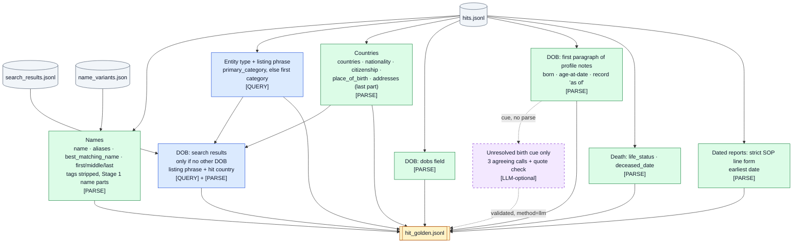
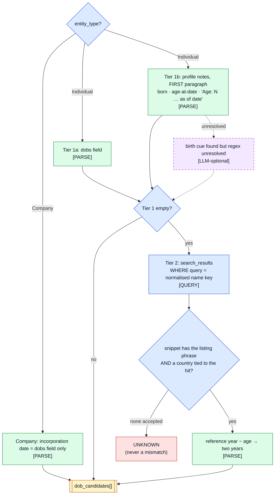

# Stage 2: Hit Golden Profile (`hit_golden`)

> **Goal:** turn each watch-list hit into one clean, traceable profile: its names, type, countries, birth-date candidates, date of death and earliest dated report. Every fact records where it came from.
>
> Part of the 4-stage architecture: **1** customer golden record · **2** hit golden profile (this doc) · **3** alert → person resolution · **4** decision rules.

| | |
|---|---|
| **Status** | ✅ Built (`system/stage2/`, PR #8; fixes in PR #10). |
| **Dev run** | 819 hits (702 individuals, 117 companies). DOB source: `dobs` only 146, `dobs` + note 6, note only 48, search 55, unknown 447. Dated reports 640 lines on 215 hits. Practice labels: 41/41 individuals and 9/9 companies agree. 0 LLM calls. <1 s. |
| **Code map** | [§9](#9-code-map) |
| **Planned refactor** | [§11](#11-refactor-plan-to-be-done). Not started. |

---

## 1. Why this stage exists

A hit's most useful facts are rarely in a tidy field:

- **Names come in many shapes.** "Surname, Given", aliases with tags such as `(AKA)` or `(Nickname)`, acronyms, and aliases written in non-Latin scripts.
- **The birth date may be hidden.** It may sit in the `dobs` field, in a sentence in the first paragraph of the profile notes ("…aged N in Month YYYY…"), or only in **web search results**, most of which are about *other people with the same name*.
- **Countries are scattered** across five fields, often buried at the end of an address.
- **Timing facts matter.** The earliest dated report and any date of death can prove the hit is someone else.

Stage 2 collects all of this once, deterministically, so the decision stage can compare like with like.

### Principles

| Principle | In practice |
|---|---|
| **Deterministic** | Joins, regex, fixed word lists; sorted output; byte-identical reruns |
| **Traceable** | Every fact: `{value, source, source_id, method, quote}` |
| **Unknown stays unknown** | No birth date found → `UNKNOWN`, never a mismatch |
| **Follow the SOP literally** | First paragraph only for note DOBs; search results only when no other DOB exists; dated reports only in the exact SOP form |
| **Stdlib only, LLM optional** | Regex covers the development set fully; an LLM is a switched-off, guarded fallback for one field |

**Coverage on the development set** (~820 hits, ~16.9k search results):

| Fact | Deterministic coverage |
|---|---|
| Birth statements in the first paragraph of profile notes | **100%** (54 of 54 found by hand review) |
| Search-result acceptance + age/year extraction | **100%** of snippets parse; matches every practice label |
| Dated reports (strict SOP form) | **100%** of lines in that form |
| Names, countries, death | fully structured |

Step labels: 🟦 **[QUERY]** join/filter · 🟩 **[PARSE]** normalisation/regex · 🟪 **[LLM-optional]** off by default.

---

## 2. Pipeline



---

## 3. Source fields

`hits.jsonl` (development set: ~700 individuals, ~120 companies)

| Field | Used for | Notes |
|---|---|---|
| `hit_id`, `alert_id` | keys | |
| `entity_type` | type | |
| `name` | primary name | ~45% written "Surname, Given" |
| `aliases[]` | names | trailing tag: `(AKA)`, `(Acronym)`, `(DBA)`, `(Nickname)`, `(None, <Script>)`, … |
| `best_matching_name` | name | always equals the name or an alias on dev; kept for safety |
| `first_name`, `middle_name`, `last_name` | name | structured copy of `name` |
| `dobs[]` | birth dates | `YYYY`, `YYYY-MM`, `YYYY-MM-DD`; only individuals on dev |
| `place_of_birth` | country | country = last comma part |
| `nationality[]`, `citizenship[]`, `countries[]` | countries | values may be "City, Region, Country" |
| `addresses[]` | countries | last comma part after removing `[Tag]` |
| `life_status`, `deceased_date` | death | |
| `categories[]`, `primary_category` | listing phrase | |
| `profile_notes` | note DOB, dated reports | free text |
| `match_score` | display only | never part of a decision |
| `identifiers`, `details`, `relationships`, `subcategories`, `position_or_allegation`, `sources`, `source_urls` | not used | the SOP doesn't list them as identity sources |

`search_results.jsonl`: `result_id`, `query`, `title`, `snippet`, `source`. Most queries are namesakes or bank names, and **company hits have no results**.

---

## 4. Rules

### 4.1 Names 🟩 [PARSE]

Each name becomes `{value, kind, tag, script, parts, source_field}`, with `kind` ∈ `primary | alias | best_matching | structured`.

- Parts come from the **same Stage 1 normaliser** (`NameTools`). Brackets are removed, accents folded, dots and apostrophes deleted, and initials, placeholders and company legal forms dropped.
- **Word order is irrelevant.** Name agreement is order-free, so "Surname, Given" needs no reordering.
- **Non-Latin aliases** (about a third of all aliases) give no Latin parts. They are kept for display, flagged, and **never transliterated**, because transliteration would be guessing. On dev every such alias has a Latin form elsewhere in the profile.
- **Nicknames** count as names (SOP). Single-part aliases are kept: the SOP allows a hit's single-part alias to agree with a customer name.

### 4.2 Entity type and listing phrase 🟦 [QUERY]

`category = primary_category`, else the first of `categories`. The SOP fixes the phrase per category:

| Category | Listing phrase |
|---|---|
| Sanctions | "a sanctioned individual" |
| PEP | "a politically exposed person" |
| Enforcement | "the subject of enforcement action" |
| Adverse Media | "named in adverse media" |
| SOE | "a state-owned enterprise official" |
| anything else | "named on a watchlist" |

### 4.3 Countries 🟩 [PARSE]

For every value in `countries`, `nationality`, `citizenship`, `addresses` and `place_of_birth`:

1. Remove `[...]` tags.
2. Take the **last comma-separated part**.
3. Normalise with the Stage 1 country table (codes, names, nationality adjectives → one canonical name).
4. Drop "International" and "Europe". Territories stay their own country.

Values the table doesn't know are kept raw with flag `UNMAPPED_COUNTRY`. The three such forms seen on dev (a special administrative region, a partially recognised state, a non-English spelling) have been added to the table.

### 4.4 Birth-date candidates

Each candidate is `{years[], month, day, precision, source, source_id, method, quote}`. An exact date gives one year. **An age at a date gives two possible years**: someone aged 45 in March 2019 was born in 1973 or 1974.



**Tier 1a: `dobs` field.** Each value is parsed with the Stage 1 date parser, precision kept. Also accepted: `c. 1970` and `1970-00-00` (year), `Mar 1970` (month), `12 Mar 1970` (day), and `1970-1972` (every year in the range). A value that still does not parse sets `DOBS_UNPARSED` and blocks search results.

**Tier 1b: profile notes (first paragraph only, as the SOP says).** The first paragraph ends at the first blank line, including a line that is only spaces or a carriage return. Rules in order:

| Rule | Generic pattern | Result |
|---|---|---|
| Born | case-insensitive "born", "birth", "DOB", or "b." plus a date, including "Born on 12 March 1970", "born in ⟨city⟩ in 1970", "5th March 1970", and an unambiguous slash date | one candidate, that precision |
| Record "as of" | "Age: N" together with "as of ⟨date⟩" (registry/prison-record style) | years `Y−N−1`, `Y−N`, `rule_strength: "strong"` |
| Age at date | exactly **one** age (from cues: "aged N", "N-year-old", "N years old", "age of N", "at age N", "was N", "reached (the age of) N", "turned N", "N years of age", ", N,") **and** exactly **one** reference date. An age right after a relative word (son, daughter, wife, and the same family) is ignored. "was N", ", N,", and "reached" are `rule_strength: "weak"`; the others are `"strong"` | years `Y−N−1`, `Y−N` |
| Otherwise, with a birth/age cue | 0 or ≥2 ages or dates, or a hit slash date with both parts 12 or under | flag `NOTE_DOB_UNRESOLVED` and do not consult search results. An optional LLM may still fill the slot; a `none` answer or an empty quote does not clear the flag |

On dev: 56 first paragraphs contain a birth statement (50 of them with no `dobs` field), and none of those statements is unresolved. The age-at-date statements alone use more than 17 different sentence shapes. That variety is why this is the one field with an LLM fallback.

**Tier 2: search results (individuals, and only if Tier 1 found nothing).**

1. Key = the hit name's words lowercased, accents folded, dots/apostrophes removed, single letters dropped, **sorted alphabetically**. Look up `search_results.query`.
2. **Accept** a result only if its snippet contains the hit's **listing phrase** verbatim **and** a **country tied to the hit**. The country is searched *after removing the subject's own name words*, so a first name that is also a country word can't sneak through.
3. Extract the single 4-digit year and the single age → two candidate years.

Dev results: about 500 individual hits reach Tier 2. About 55 get exactly one accepted result; the rest have **no birth date from any source** (→ UNKNOWN). Rejections are about 94% wrong phrase and 6% wrong country. Every search result cited in the practice labels is accepted, and nothing else is.

**Companies.** Only the `dobs` field is an incorporation date (SOP). No company hit has one on dev.

### 4.5 Death 🟩 [PARSE]

`deceased = {life_status, date, precision}` from the fields only. "Deceased" without a date is flagged `DECEASED_NO_DATE` and can't support a DECEASED clear, which needs a date before the screening date. Death words in profile notes on dev never refer to the subject, so they are not used.

### 4.6 Dated reports 🟩 [PARSE]

The SOP defines dated reports as **exactly** the English lines of the form

```text
According to <source>; <Month> <DD>, <YYYY>: <text>
```

and says the form is worded the same in the unseen set. One line-anchored regex extracts them. About 80% of "According to…" lines on dev match. The rest are deliberately different forms that **don't count**: colon instead of semicolon, trailing semicolon, month-year or year only, "as of…", "found on…", and non-English lines. Stage 2 stores every dated report and the **earliest** one, which the decision stage compares with the customer's age (younger than 16 → temporal impossibility) or a company's incorporation date.

---

## 5. LLM placement and guardrails 🟪

| Fact | LLM? | Why |
|---|---|---|
| Names, aliases, scripts | No | deterministic; no transliteration |
| Countries | No | lexicon |
| `dobs` field | No | structured |
| **Profile-note birth sentence** | **Optional fallback** | wording varies most here; only when a birth/age cue exists and regex can't resolve exactly one statement |
| Search-result acceptance | No | SOP fixes the listing phrases |
| Search-result age/year | No (optional trigger if a snippet has ≠1 age) | 100% on dev |
| Dated reports | No | SOP fixes the form |
| Death | No | fields only |

**Guardrails (agreed):**

- **Off by default** (`USE_LLM_HITS=0`). `SANCTIONS_LLM=0` forces this fallback off as well. **OpenRouter only**, key from `OPENROUTER_API_KEY`, never committed. One shared client per run: 12 calls per extraction, 48 calls for the run, and a 20 minute time backstop.
- **Pinned model and pinned provider** (no provider fallback), **temperature 0**, **strict JSON schema**: `{statement: born|age_at_date|none, born_date, age, reference_date, quote}`.
- Input is the hit name plus **the first paragraph only**.
- **Quote check:** `quote` must be a non-empty verbatim substring of the paragraph. An empty or null quote does not count. Age and dates must re-parse *from the quote* with our deterministic parsers. Birth years are computed by our code, never by the model. A `none` answer does not clear `NOTE_DOB_UNRESOLVED`.
- **Three independent calls must agree exactly**, otherwise the fact is `UNKNOWN`.
- **Nothing is cached** in the code on main (the shared client keeps no cache). A cache would not exist on the judges' machine anyway, so reproducibility must not rely on it.
- Every LLM-derived candidate carries `method: "llm"`. **An LLM fact can never contribute to a `DIFFERENT_ENTITY` clearance**, not only when it would be the sole ground. It can only push a hit to `REVIEW` or support a `SAME_ENTITY` confirmation. A weak regex age (`rule_strength: "weak"`, from "was N", ", N,", or "reached") likewise cannot be the only ground for a clearance.

---

## 6. Output: `hit_golden.jsonl` (synthetic example)

```json
{
  "hit_id": "H-SYNA0A",
  "alert_id": "A-0B0B0B",
  "entity_type": "Individual",
  "match_score": 95,
  "names": [
    {"value": "Example, Jane Quinn", "kind": "primary", "parts": ["example", "jane", "quinn"], "script": "latin", "tag": null, "source_field": "name"},
    {"value": "Jane Exampel (AKA)", "kind": "alias", "parts": ["jane", "exampel"], "script": "latin", "tag": "AKA", "source_field": "aliases[0]"},
    {"value": "<non-Latin script>", "kind": "alias", "parts": [], "script": "non_latin", "tag": "None, Cyrillic", "source_field": "aliases[1]"}
  ],
  "listing": {"category": "PEP", "phrase": "a politically exposed person", "from": "primary_category"},
  "countries": [
    {"value": "Ireland", "field": "addresses", "raw": "1 Example Street, Dublin, Ireland [Business]"},
    {"value": "Ireland", "field": "citizenship", "raw": "Ireland"}
  ],
  "dob_candidates": [
    {"years": [1979, 1980], "month": null, "day": null, "precision": "year",
     "source": "profile_note", "source_id": "H-SYNA0A", "method": "regex",
     "rule": "age_at_date", "quote": "aged 40 in June 2020"}
  ],
  "dob_tier": "tier1",
  "incorporation_dates": [],
  "deceased": {"life_status": "Alive", "date": null},
  "dated_reports": [{"date": "2015-03-02", "line_index": 2}, {"date": "2018-11-30", "line_index": 0}],
  "earliest_dated_report": {"date": "2015-03-02", "line_index": 2},
  "search_results": {"key": "example jane quinn", "considered": ["SR-0C0C0C", "SR-0D0D0D"], "accepted": [], "rejected": {"phrase": 2, "country": 0}},
  "flags": ["NON_LATIN_ALIAS"]
}
```

**Flags:** `NON_LATIN_ALIAS`, `UNMAPPED_COUNTRY`, `NO_COUNTRY`, `NO_DOB`, `NOTE_DOB_UNRESOLVED`, `DOBS_UNPARSED`, `LLM_UNKNOWN`, `DECEASED_NO_DATE`, `MULTI_SR_CONFLICT`. `NOTE_DOB_UNRESOLVED` and `DOBS_UNPARSED` both block search results.

---

## 7. Edge cases and tests (generic)

| # | Case | Expected |
|---|---|---|
| 1 | "Surname, Given" vs "Given Surname" | identical parts |
| 2 | Every alias tag type | tag stripped and recorded; nickname kept |
| 3 | Non-Latin alias | no parts, flagged, never matched |
| 4 | Single-part alias | kept |
| 5 | Company legal forms in hit names | dropped |
| 6 | `dobs` with mixed precision | each parsed with its precision |
| 7 | `dobs` **and** a note DOB | both kept as Tier 1 candidates |
| 8 | "born on ⟨date⟩" / "born in ⟨year⟩" | one candidate |
| 9 | Age-at-date in many sentence shapes | two years each |
| 10 | Birth statement outside the first paragraph | ignored |
| 11 | Two ages or two dates in the first paragraph | unresolved → LLM or UNKNOWN |
| 12 | Numbers that aren't ages (counts, sums, sentences) | not extracted |
| 13 | Search result with the right phrase, wrong country | rejected |
| 14 | Subject's first name is a country word | not accepted on that basis |
| 15 | Company hit | no search results consulted |
| 16 | Tier 1 present | search results not consulted |
| 17 | Several accepted results | all kept |
| 18 | Strict dated-report line | counted |
| 19 | Near-miss forms (colon, trailing semicolon, month-year, year, "as of") | not counted |
| 20 | Non-English report line | not counted |
| 21 | Several dated reports | earliest selected |
| 22 | Deceased with / without date | date kept / flagged |
| 23 | Nationality written as "City, Region, Country" | country extracted |
| 24 | "International" / "Europe" / territories | dropped / dropped / kept |
| 25 | Unknown country form | raw + flag |
| 26 | LLM: quote missing from text · calls disagree · cache hit · switched off | rejected · UNKNOWN · no network · never called |
| 27 | Determinism | byte-identical output |
| 28 | Regression vs practice labels | DOB sources reproduced |

---

## 8. What Stage 4 consumes

- `names[].parts` → name agreement with the customer's verified legal name (Stage 1).
- `dob_candidates[]` → a DOB contradiction needs **every** candidate contradicted; one agreeing candidate blocks a DOB-based clear.
- `countries[]` → location mismatch only when disjoint from **all** customer countries, and never when name and DOB agree.
- `earliest_dated_report` → temporal impossibility; `deceased.date` vs the alert's screening date → deceased.
- `entity_type` → entity-type mismatch.
- `method: "llm"` facts → never contribute to a `DIFFERENT_ENTITY` clearance. `rule_strength: "weak"` ages cannot be the only ground for one either.
- Accepted search-result IDs → cited as evidence when they supplied the deciding DOB.

---

## 9. Code map

| File | Lines | What it does |
|---|---|---|
| `system/stage2/build.py` | ~340 | `build_hit` assembles one profile (§4.4 tiers, death, reports); `build_profiles` runs every hit in `hit_id` order; `run_stage2` writes `hit_golden.jsonl` and returns stats (including the practice-label check) |
| `system/stage2/names.py` | ~90 | `hit_names`: name, aliases, best-matching and structured names → parts via Stage 1 `NameTools` (§4.1) |
| `system/stage2/listing.py` | ~35 | `listing`: category → listing phrase (§4.2) |
| `system/stage2/countries.py` | ~55 | `hit_countries`: last comma part of each country field via Stage 1 `norm_country` (§4.3) |
| `system/stage2/notes.py` | ~250 | `parse_note_dob` (first-paragraph birth and age sentences), `parse_dated_reports` (§4.4 tier 1b, §4.6) |
| `system/stage2/search.py` | ~100 | `evaluate_search`: tier 2 search-result acceptance and age/year extraction |
| `system/stage2/llm.py` | ~215 | `NoteFallback`: optional LLM for unresolved birth sentences (§5) |
| `system/stage2/practice.py` | ~90 | Checks profiles against `practice_labels.jsonl` (evaluation, not pipeline logic) |

Tests: `system/tests/test_stage2.py`, `test_stage2_repro.py` (dev folder, skipped when absent).

## 10. Known gaps

| Gap | Effect |
|---|---|
| The age-sentence rules were written from dev wording. The brief says unseen free text is worded differently | Coverage on unseen data is unknown. Unresolved sentences become `NOTE_DOB_UNRESOLVED` (safe: no clear on DOB, no search results) |
| Re-check counts and coverage on the **updated dataset** | The figures in §1 and the header are from the old dev folder |
| The weak-age rule (`rule_strength: "weak"`) and the LLM-fact rule are recorded on each candidate but enforced only in Stage 4 | Stage 4 must read them |

## 11. Refactor plan (to be done)

Same output, byte for byte. When a step lands, change its status to **Done** and add the commit.

| ID | Change | Why | Status |
|---|---|---|---|
| R2.1 | Import names, dates and countries from `system/shared/` after the Stage 1 move (Stage 1 doc, R1.1) | No stage should import another stage's internals | To do |
| R2.2 | Remove the duplicate `_age_years` (in both `notes.py` and `llm.py`): keep one in `notes.py` and import it | Same rule in two places can drift | To do |
| R2.3 | Use the shared quote check: `llm.py` has its own `_quoted`, and `shared/llm_client.py` has another. Keep the shared one, plus the Stage 2-specific "non-empty quote" rule as a small wrapper | One validation rule | To do |
| R2.4 | Move `practice.py` and the practice call in `run_stage2` into the evaluation tool (shared doc, RS.5) | The pipeline produces answers; evaluation is separate | To do |
| R2.5 | Use the shared JSONL reader and the single LLM switch helper (shared doc, RS.2, RS.3) | One reader, one switch | To do |
