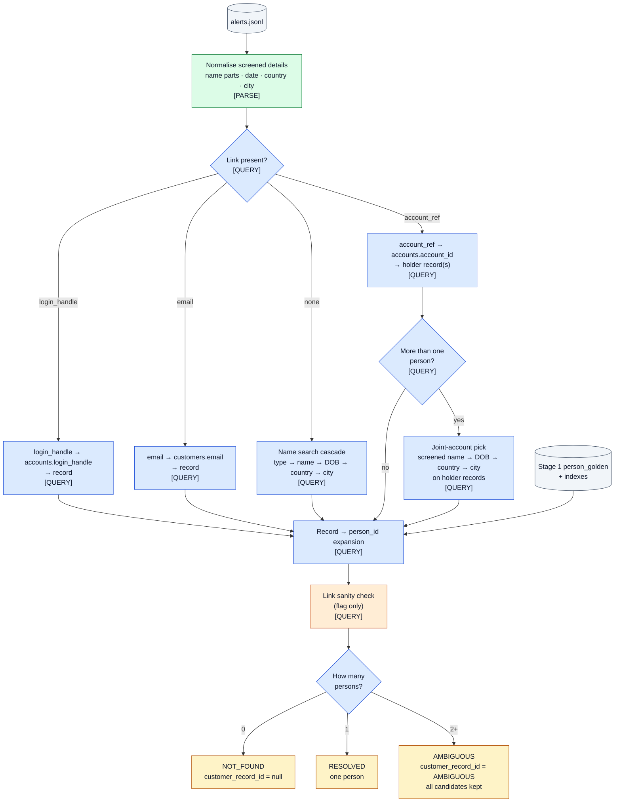
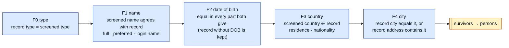
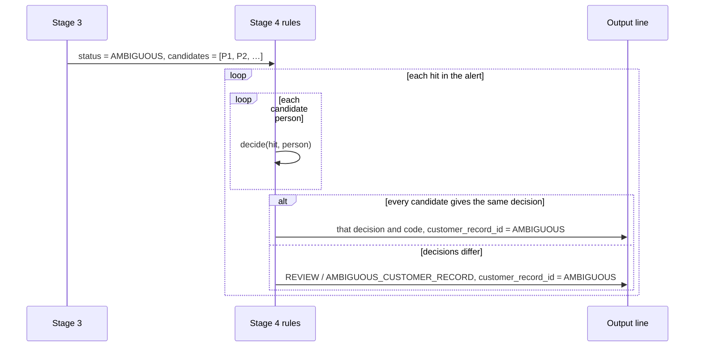

# Stage 3: Alert → Person Resolution (`alert_resolution`)

> **Goal:** for every screening alert, find the person (or people) in the Stage 1 golden table that the alert is about, with a step-by-step trace of how.
>
> Part of the 4-stage architecture: **1** customer golden record · **2** hit golden profile · **3** alert → person resolution (this doc) · **4** decision rules.

---

## 1. Why this stage exists

An alert shows the customer **as screened**: a name (sometimes a nickname or a typo), a type, and sometimes a date of birth, country and city. Some alerts carry a **link** (account number, login or email). Many don't. Before any hit can be judged, we must know which customer the alert is about:

- **Follow the link when there is one** (SOP), but an account can have **two holders** (joint accounts).
- **Without a link, search.** The system of record has ~72k records and very few distinct names, so the search must narrow by date of birth, country and city.
- **Records are not people.** A match on one record pulls in the whole Stage 1 person.
- **If more than one person fits, say so.** The decision stage then decides each hit for every candidate.

### Principles

| Principle | In practice |
|---|---|
| **Deterministic** | Exact joins and ordered filters, sorted candidates, byte-identical reruns |
| **Traceable** | Method, survivor counts after each filter, why each candidate fits or not |
| **Unknown stays unknown** | A record with no date of birth is not excluded by a date filter |
| **Never borrow** | Only records of the chosen person(s) are used downstream |
| **No LLM** | Nothing here needs free-text reading |

**Validation:** on the development set the resolver reproduces the customer resolution of **all 50 practice labels (50/50)**, including joint-account picks, merged multi-record persons and both ambiguous cases.

Step labels: 🟦 **[QUERY]** join/filter · 🟩 **[PARSE]** normalisation.

---

## 2. Pipeline



---

## 3. Inputs

| Source | Fields |
|---|---|
| `alerts.jsonl` | `alert_id`, `screened_at`, `customer.name`, `customer.entity_type`, `customer.dob`, `customer.country`, `customer.city`, `account_ref`, `login_handle`, `email`, `hit_ids` |
| `accounts.jsonl` | `account_id`, `customer_id`, `login_handle` |
| `customers.jsonl` (or a Stage 1 per-record block) | `record_id`, `entity_type`, `full_name`, `preferred_name`, `login_name`, `dob`, `residence_country`, `nationality`, `city`, `address`, `email` |
| Stage 1 | `index_record_id` (record → person), `index_name` (name-part blocking), `person_golden` (`record_ids`, `names_all`, `declared_dobs`, `countries`) |

On the development set the link types are mutually exclusive: about 39% of alerts carry an account number, 16% a login, 12% an email, and **33% no link**.

> **Stage 1 interface note.** Stage 3 matches the *screened* details against each **record's** declared values (full / preferred / login name, declared date of birth, residence, nationality, city, address). The verified legal name is **not** used for searching (SOP). So Stage 3 either reads `customers.jsonl` directly, or Stage 1 publishes a per-record block plus record-level account and login indexes.

---

## 4. Rules

### 4.1 Normalise the screened details 🟩 [PARSE]

Reuse Stage 1 functions: name parts (placeholders, initials, legal forms dropped), partial-aware date parsing, country canonicalisation, and folded text for the city.

### 4.2 Follow the link 🟦 [QUERY]

| Link | Join | Result |
|---|---|---|
| `account_ref` | `accounts.account_id` | 1 holder record, or **2 for a joint account** (~1 in 3 account links on dev) |
| `login_handle` | `accounts.login_handle` (unique) | 1 record |
| `email` | `customers.email` (case-insensitive, unique) | 1 record |

Each record maps to its `person_id`. If that gives one person, the alert is **RESOLVED**. A link value that matches nothing is flagged `DANGLING_LINK` and the alert falls back to name search.

### 4.3 Joint-account holder pick 🟦 [QUERY]

The SOP says a link can lead to more than one person, and the screened details then pick between them as in a search without a link. So the same filters as the name search (name → date of birth → country → city) run on the **holder records only**:

- exactly one person fits → **RESOLVED** (`LINK_ACCOUNT_JOINT`)
- more than one fits → **AMBIGUOUS**
- none fits → **UNRESOLVED_LINK** (no customer; flagged; never picked arbitrarily)

On dev, every joint-account alert resolves to exactly one holder.

### 4.4 Name search cascade (no link) 🟦 [QUERY]

Only the filters for fields the alert actually gives are applied. They are ANDed, in this order, and the survivor count is logged after each step:



- **F1 name** uses the Stage 1 SOP name rule (variants, joined/split parts, small spelling edits, nicknames, order-free). It is blocked through the name-part index so it never scans every record with fuzzy matching.
- **F2 date of birth:** a year-only screened date is compatible with any full date in that year.
- **F3 country:** codes, names and nationality adjectives are compared after normalisation.

Dev (unlinked alerts): about 80% resolve to one person and about 20% are ambiguous (2–6 persons). None come back empty.

### 4.5 Record → person expansion 🟦 [QUERY]

Every surviving record brings in its whole Stage 1 person (records joined by phone + date of birth, or by a shared approved document number). Two surviving records of the **same** person still mean **one** candidate.

### 4.6 Link sanity check 🟦 [QUERY] (flag only)

The SOP says to follow whatever link the alert carries. For extra safety we still test the screened name and date of birth against the linked person's records. If they contradict, the link is **still followed**, and the alert is flagged `LINK_SUSPECT` so the decision stage won't clear on it. On dev there are **no** such cases: every linked customer agrees with the screened details.

### 4.7 Which `customer_record_id`

| Status | Value |
|---|---|
| RESOLVED via link | the linked record (for a joint account, the fitting holder) |
| RESOLVED via search | the smallest record ID among the matching records (any record of the person is accepted) |
| AMBIGUOUS | `"AMBIGUOUS"` |
| NOT_FOUND / UNRESOLVED_LINK | `null` |

---

## 5. Ambiguity hand-off to Stage 4



Evidence for an ambiguous alert cites every candidate's customer records plus the records that decided the hit.

---

## 6. Output: `alert_resolution.jsonl` (synthetic example)

```json
{
  "alert_id": "A-0E0E0E",
  "screened": {
    "name": "Jane Example", "parts": ["jane", "example"], "entity_type": "Individual",
    "dob": {"value": "1980", "precision": "year"}, "country": "Ireland", "city": null
  },
  "method": "NAME_SEARCH",
  "status": "AMBIGUOUS",
  "filter_counts": {"F0_type": 64000, "F1_name": 85, "F2_dob": 3, "F3_country": 2},
  "candidates": [
    {"person_id": "P-CUS-000111", "record_ids": ["CUS-000111"], "matched_records": ["CUS-000111"],
     "why": {"name": {"field": "full_name", "pairs": ["jane=jane", "example=example"]}, "dob": "compatible", "country": "Ireland"}},
    {"person_id": "P-CUS-000222", "record_ids": ["CUS-000222", "CUS-000333"], "matched_records": ["CUS-000333"],
     "why": {"name": {"field": "preferred_name", "pairs": ["jane=jane", "example=exampel"]}, "dob": "compatible", "country": "Ireland"}}
  ],
  "rejected_holders": [],
  "chosen_person_ids": ["P-CUS-000111", "P-CUS-000222"],
  "customer_record_id": "AMBIGUOUS",
  "trace": [
    "no link",
    "name search: type 64000 -> name 85 -> dob 3 -> country 2",
    "2 records -> 2 persons -> AMBIGUOUS"
  ],
  "flags": []
}
```

- `method`: `LINK_ACCOUNT` · `LINK_ACCOUNT_JOINT` · `LINK_LOGIN` · `LINK_EMAIL` · `NAME_SEARCH`
- `status`: `RESOLVED` · `AMBIGUOUS` · `NOT_FOUND` · `UNRESOLVED_LINK`
- `flags`: `DANGLING_LINK` · `LINK_SUSPECT` · `RECORD_DOB_MISSING_KEPT` · `NAME_TOO_SHORT`

---

## 7. Edge cases and tests (generic)

| # | Case | Expected |
|---|---|---|
| 1 | Account link, single holder | RESOLVED |
| 2 | Joint account, one holder fits | that holder; the other recorded in `rejected_holders` |
| 3 | Joint account, both fit | AMBIGUOUS |
| 4 | Joint account, neither fits | UNRESOLVED_LINK, null |
| 5 | Login link / email link (mixed case) | RESOLVED |
| 6 | Link value not found | `DANGLING_LINK` → name search |
| 7 | Linked record is part of a multi-record person | whole person returned |
| 8 | Linked customer contradicts the screened details | still followed, `LINK_SUSPECT` |
| 9 | Screened nickname or typo | agrees via variants / edit distance |
| 10 | Year-only screened DOB vs full record DOB | compatible |
| 11 | Record without a DOB | kept, flagged |
| 12 | Country as code / name / adjective | normalised before comparing |
| 13 | City matched via address text | matches |
| 14 | Company alert | legal forms ignored; incorporation date used as DOB |
| 15 | Other entity type | excluded by F0 |
| 16 | Two surviving records of one person | RESOLVED, not AMBIGUOUS |
| 17 | Two or more persons survive | AMBIGUOUS, all candidates and counts kept |
| 18 | Nobody survives | NOT_FOUND, null |
| 19 | Placeholder tokens in the screened name | removed; fewer than 2 real parts flagged |
| 20 | Verified legal name equals the screened name but record names don't | not used for search (SOP) |
| 21 | Determinism | byte-identical output |
| 22 | Regression | all practice labels resolve to the labelled customer records |

---

## 8. What Stage 4 consumes

- **RESOLVED** → each hit is decided against one person; `customer_record_id` comes from here.
- **AMBIGUOUS** → each hit is decided per candidate and combined (§5).
- **NOT_FOUND / UNRESOLVED_LINK** → no customer facts; the hit goes to `REVIEW / INSUFFICIENT_DATA`, with `customer_record_id = null`.
- **LINK_SUSPECT** → the decision stage must not clear the hit.
