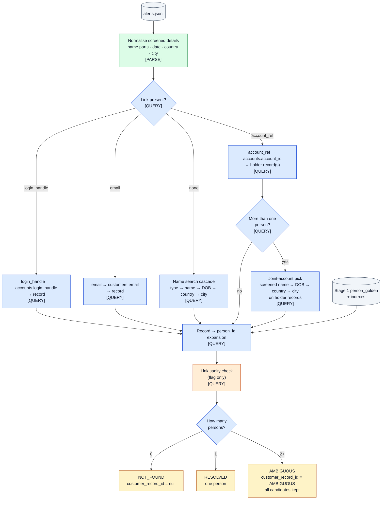
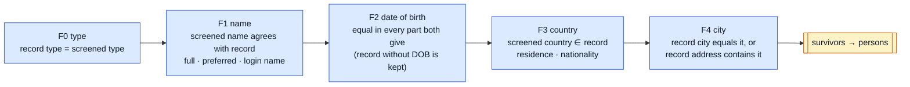
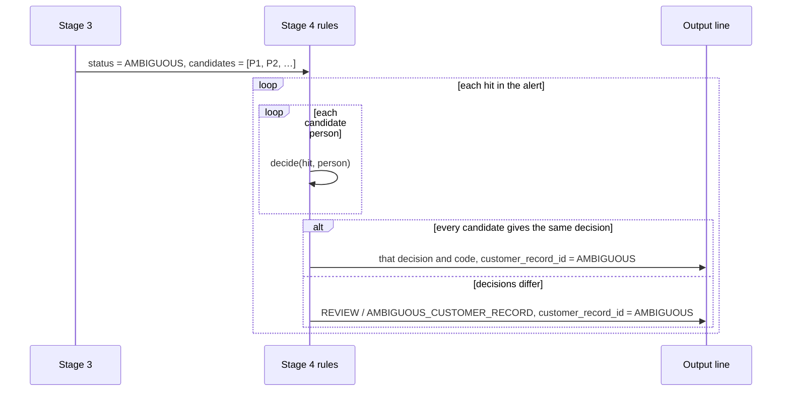

# Stage 3: Alert → Person Resolution (`alert_resolution`)

> **Goal:** for every screening alert, find the person (or people) in the Stage 1 golden table that the alert is about, with a step-by-step trace of how.
>
> Part of the 4-stage architecture: **1** customer golden record · **2** hit golden profile · **3** alert → person resolution (this doc) · **4** decision rules.

| | |
|---|---|
| **Status** | ✅ Built (`system/stage3/`, PR #9). Does not decide hits. |
| **Dev run** | 440 alerts: 413 resolved to one person, 27 ambiguous, 0 not found. Joint accounts 58/58 resolved. Practice labels 50/50. ~8 s. No LLM. |
| **Code map** | [§9](#9-code-map) |
| **Planned refactor** | [§11](#11-refactor-plan-to-be-done). Not started. |

---

## 1. Why this stage exists

An alert shows the customer **as screened**: a name (sometimes a nickname or a typo), a type, and sometimes a date of birth, country and city. Some alerts carry a **link** (account number, login or email). Many don't. Before any hit can be judged, we must know which customer the alert is about:

- **Follow the link when there is one** (SOP), but an account can have **two holders** (joint accounts).
- **Without a link, search.** The system of record on dev has 72,265 records and very few distinct names, so the search must narrow by date of birth, country and city.
- **Records are not people.** A match on one record pulls in the whole Stage 1 person.
- **If more than one person fits, say so.** The decision stage then decides each hit for every candidate.

### Principles

| Principle | In practice |
|---|---|
| **Deterministic** | Exact joins and ordered filters, sorted candidates, byte-identical reruns |
| **Traceable** | Method, survivor counts after each filter, why each candidate fits or not |
| **Unknown stays unknown** | A record with no date of birth is not excluded by a date filter |
| **Never borrow** | Only records of the chosen person(s) are used downstream |
| **No LLM** | Nothing here needs free-text reading |

**Dev run** (one `system/run`, LLM off): 440 alerts, 413 `resolved_single`, 27 `ambiguous`, 0 `not_found`. Joint accounts 58/58 resolved to one holder. Linked alerts 294 (112 single-holder account, 58 joint, 70 login, 54 email). Unlinked 146: 119 resolved, 27 ambiguous. `resolution_clean` 307. `resolution_quality`: `clean_link` 236, `unique_search_match` 119, `joint_account_pick` 58, `ambiguous` 27. Fragility: `candidate_kept_on_missing_field` 128, `joint_account_tiebreak` 58, `dob_partial_only` 32, `name_match_fuzzy_only` 2. Operational flags: `NAME_TOO_SHORT` 22, `RECORD_DOB_MISSING_KEPT` 1. No `link_contradicts_screened`, no dangling link, no `unresolved_joint_link`. Practice labels **50/50**. Of the 307 clean resolutions, 20 also carry `NAME_TOO_SHORT` (16 of those are `clean_link`). `resolution_clean` does not make a one-part name safe to confirm or clear on.

Step labels: 🟦 **[QUERY]** join/filter · 🟩 **[PARSE]** normalisation.

---

## 2. Pipeline



---

## 3. Inputs

| Source | Fields |
|---|---|
| `alerts.jsonl` | `alert_id`, `screened_at`, `customer.name`, `customer.entity_type`, `customer.dob`, `customer.country`, `customer.city`, `account_ref`, `login_handle`, `email`, `hit_ids` |
| `accounts.jsonl` | `account_id`, `customer_id`, `login_handle` |
| `customers.jsonl` (or a Stage 1 per-record block) | `record_id`, `entity_type`, `full_name`, `preferred_name`, `login_name`, `dob`, `residence_country`, `nationality`, `city`, `address`, `email` |
| Stage 1 cache | `record_view.jsonl`, `index_account_record_id.json`, `index_login_record_id.json`, `index_email_record_id.json`, `index_name_part_record_id.json`. `index_name.json` is not read. `customers.jsonl` is read only to recover a company's declared date of birth |

On the reproduced dev run the link types are mutually exclusive: 170 account (112 single-holder, 58 joint), 70 login, 54 email, and 146 with no link.

> **Stage 1 interface note.** Stage 3 matches the *screened* details against each **record's** declared values on `record_view.jsonl` (full / preferred / login name, declared date of birth, residence, nationality, city, address). The verified legal name is **not** used for searching (SOP). It does not read `index_name.json`. For a company it replaces the view's date with `customers.dob`, because the view may hold the registry incorporation date.

---

## 4. Rules

### 4.1 Normalise the screened details 🟩 [PARSE]

Reuse Stage 1 functions: name parts (placeholders, initials, legal forms dropped), partial-aware date parsing, country canonicalisation, and folded text for the city.

### 4.2 Follow the link 🟦 [QUERY]

| Link | Join | Result |
|---|---|---|
| `account_ref` | `accounts.account_id` | 1 holder record, or 2 for a joint account (58 of 170 account links on this dev run) |
| `login_handle` | `accounts.login_handle`, trimmed and casefolded | 1 record on dev |
| `email` | `customers.email` (trimmed, lowercased) | 1 record |

Each record maps to its `person_id`. If that gives one person, the alert is **RESOLVED**. A link value that matches nothing is flagged `DANGLING_LINK` and the alert falls back to name search.

### 4.3 Joint-account holder pick 🟦 [QUERY]

The SOP says a link can lead to more than one person, and the screened details then pick between them as in a search without a link. So the same filters as the name search (name → date of birth → country → city) run on the **holder records only**:

- exactly one person fits → **RESOLVED** (`LINK_ACCOUNT_JOINT`)
- more than one fits → **AMBIGUOUS**
- none fits → `status` `UNRESOLVED_LINK`, `resolution_status` `not_found`, `resolution_reason` `unresolved_joint_link`, `customer_record_id` null. Never picked arbitrarily.

On the reproduced dev run, every joint-account alert resolved to exactly one holder.

### 4.4 Name search cascade (no link) 🟦 [QUERY]

Only the filters for fields the alert actually gives are applied. They are ANDed, in this order, and the survivor count is logged after each step:



- **F1 name** uses the Stage 1 SOP name rule (variants, joined/split parts, small spelling edits, nicknames, order-free). `shared.names.agree_parts` is symmetric since PR #10. Stage 3 calls it once per pair. The blocking index is `index_name_part_record_id.json` (exact parts only). It is expanded with variant groups, edit distance and joined or split forms before the full name rule confirms a candidate. `index_name.json` is not read, because it can contain the verified legal name.
- **Companies.** The date filter uses the declared `customers.dob`, not `record_view.dob`. For a company the view's date is the registry incorporation date when an approved registry extract exists. Principle 2 compares the date the customer declared.
- **F2 date of birth:** a year-only screened date is compatible with any full date in that year.
- **F3 country:** codes, names and nationality adjectives are compared after normalisation.

Dev (unlinked alerts, this run): 119 resolved to one person and 27 were ambiguous. None came back empty.

### 4.5 Record → person expansion 🟦 [QUERY]

Every surviving record brings in its whole Stage 1 person (records joined by phone + date of birth, or by a shared approved document number). Two surviving records of the **same** person still mean **one** candidate.

### 4.6 Link sanity check 🟦 [QUERY] (flag only)

The SOP says to follow whatever link the alert carries. For extra safety we still test the screened name and date of birth against the linked person's records. If they contradict, the link is **still followed**. The fragility flag is `link_contradicts_screened` (this replaces the design name `LINK_SUSPECT`). `resolution_quality` is then `LINK_SUSPECT`, and `resolution_clean` is false. Stage 4 must not clear it. On the reproduced dev run there were **no** such cases.

### 4.7 Which `customer_record_id`

| Status | Value |
|---|---|
| RESOLVED via link | the linked record (for a joint account, the fitting holder) |
| RESOLVED via search | the smallest record ID among the matching records (any record of the person is accepted) |
| AMBIGUOUS | `"AMBIGUOUS"` |
| `not_found`, including `UNRESOLVED_LINK` | `null`. `resolution_reason` is `unresolved_joint_link` for a joint account neither holder fits, and `dangling_link` when a missing link fell through to search and that search also found nobody |

---

## 5. Ambiguity hand-off to Stage 4



Evidence for an ambiguous alert cites every candidate's customer records plus the records that decided the hit.

---

## 6. Output: `alert_resolution.jsonl` (synthetic example)

```json
{
  "alert_id": "A-0E0E0E",
  "screened": {
    "name": "Jane Example", "parts": ["jane", "example"], "entity_type": "Individual",
    "dob": {"value": "1980", "precision": "year"}, "country": "Ireland", "city": null
  },
  "method": "NAME_SEARCH",
  "status": "AMBIGUOUS",
  "filter_counts": {"F0_type": 64000, "F1_name": 85, "F2_dob": 3, "F3_country": 2},
  "candidates": [
    {"person_id": "P-CUS-SYN111", "record_ids": ["CUS-SYN111"], "matched_records": ["CUS-SYN111"],
     "why": {"name": {"field": "full_name", "pairs": ["jane=jane", "example=example"]}, "dob": "compatible", "country": "Ireland"}},
    {"person_id": "P-CUS-SYN222", "record_ids": ["CUS-SYN222", "CUS-SYN333"], "matched_records": ["CUS-SYN333"],
     "why": {"name": {"field": "preferred_name", "pairs": ["jane=jane", "example=exampel"]}, "dob": "compatible", "country": "Ireland"}}
  ],
  "rejected_holders": [],
  "chosen_person_ids": ["P-CUS-SYN111", "P-CUS-SYN222"],
  "customer_record_id": "AMBIGUOUS",
  "trace": [
    "no link",
    "name search: type 64000 -> name 85 -> dob 3 -> country 2",
    "2 records -> 2 persons -> AMBIGUOUS"
  ],
  "flags": []
}
```

The example above is the legacy shape. The file on main also has the fields below. Keys are sorted. Alerts are sorted by `alert_id`.

| Field | Meaning |
|---|---|
| `resolution_method` | `link_account`, `link_login`, `link_email`, or `name_search` |
| `resolution_status` | `resolved_single`, `ambiguous`, or `not_found` |
| `resolution_reason` | `null`, `dangling_link`, or `unresolved_joint_link` |
| `resolution_quality` | `clean_link`, `unique_search_match`, `joint_account_pick`, `LINK_SUSPECT`, `DANGLING_LINK_fallback`, `ambiguous`, or `not_found` |
| `resolution_clean` | True only when `resolution_status` is `resolved_single` and `fragility_flags` is empty |
| `evidence_ids` | Ids that decided the resolution: surviving matched `CUS-` ids, plus the account id when an account link was followed |
| `considered_ids` | Record ids that were compared and did not decide it |
| `candidates[].filters` | `applied`, `passed`, and `skipped_missing` (`{filter, side}` with side `alert` or `record`) for name, dob, country, and city |
| `candidates[].fragility_flags` | That candidate's flags. The alert's `fragility_flags` is the sorted union |

`method` and `status` are the legacy labels: `LINK_ACCOUNT`, `LINK_ACCOUNT_JOINT`, `LINK_LOGIN`, `LINK_EMAIL`, `NAME_SEARCH`, and `RESOLVED`, `AMBIGUOUS`, `NOT_FOUND`, `UNRESOLVED_LINK`. `UNRESOLVED_LINK` stays in `status`. `resolution_status` maps it to `not_found`.

Fragility flags, sorted: `candidate_kept_on_missing_field`, `dob_partial_only`, `joint_account_tiebreak`, `link_contradicts_screened`, `name_match_fuzzy_only`, `resolved_via_note_country`.

`link_contradicts_screened` is the field that the design called `LINK_SUSPECT`. The link is still followed. `resolution_quality` uses the old name `LINK_SUSPECT` for that case.

Operational `flags`, not fragility: `DANGLING_LINK`, `NAME_TOO_SHORT`, `RECORD_DOB_MISSING_KEPT`. A missing screened field on a search or a joint pick is `candidate_kept_on_missing_field`. A direct link does not run those filters, so a missing screened city on a link is not that flag. A record with no date of birth, country, or city is kept. Unknown is not a mismatch.

---

## 7. Edge cases and tests (generic)

| # | Case | Expected |
|---|---|---|
| 1 | Account link, single holder | RESOLVED |
| 2 | Joint account, one holder fits | that holder; the other recorded in `rejected_holders` |
| 3 | Joint account, both fit | AMBIGUOUS |
| 4 | Joint account, neither fits | UNRESOLVED_LINK, null |
| 5 | Login link / email link (mixed case) | RESOLVED |
| 6 | Link value not found | `DANGLING_LINK` → name search |
| 7 | Linked record is part of a multi-record person | whole person returned |
| 8 | Linked customer contradicts the screened details | still followed, fragility `link_contradicts_screened`, quality `LINK_SUSPECT` |
| 9 | Screened nickname or typo | agrees via variants / edit distance |
| 10 | Year-only screened DOB vs full record DOB | compatible |
| 11 | Record without a DOB | kept, flagged |
| 12 | Country as code / name / adjective | normalised before comparing |
| 13 | City matched via address text | matches |
| 14 | Company alert | legal forms ignored; search date is the declared `customers.dob`, not the registry incorporation date on the record view |
| 15 | Other entity type | excluded by F0 |
| 16 | Two surviving records of one person | RESOLVED, not AMBIGUOUS |
| 17 | Two or more persons survive | AMBIGUOUS, all candidates and counts kept |
| 18 | Nobody survives | NOT_FOUND, null |
| 19 | Placeholder tokens in the screened name | removed; fewer than 2 real parts flagged |
| 20 | Verified legal name equals the screened name but record names don't | not used for search (SOP) |
| 21 | Determinism | byte-identical output |
| 22 | Regression | all practice labels resolve to the labelled customer records |

---

## 8. What Stage 4 consumes

Nothing here decides a hit. These are the rules Stage 4 must apply to Stage 3's output.

- **`resolved_single`** → each hit is decided against one person. `customer_record_id` comes from here.
- **`ambiguous`** → each hit is decided per candidate and combined (§5). Do not pick one person. `customer_record_id` is `AMBIGUOUS`.
- **`not_found`**, including `unresolved_joint_link` → no customer facts. The hit goes to `REVIEW` / `INSUFFICIENT_DATA`, with `customer_record_id` null.
- **`resolution_clean` false**, `link_contradicts_screened` (quality `LINK_SUSPECT`), and `DANGLING_LINK_fallback` → do not clear.
- **`NAME_TOO_SHORT`** is not a fragility flag. A clean resolution can still have it. Do not confirm or clear that customer on name.
- **`candidate_kept_on_missing_field`** means a missing dob, country, or city was unknown, not a mismatch. Do not clear on that missing field.
- **`dob_partial_only`** and **`name_match_fuzzy_only`** are weak agreement.
- **`resolved_via_note_country`** did not occur on dev. If it does, the country came from a note tag on residence or nationality. Do not clear on location from that alone.

---

## 9. Code map

| File | Lines | What it does |
|---|---|---|
| `system/stage3/resolve.py` | ~810 | `normalise_screened` (§4.1); `Resolver` follows links (§4.2), picks joint-account holders (§4.3), runs the search cascade (§4.4), expands records to persons (§4.5), runs the link check (§4.6) and sets fragility, quality and `customer_record_id` (§4.7). `resolve_alerts` runs every alert in `alert_id` order |
| `system/stage3/stage1_adapter.py` | ~260 | `load_catalog`: reads the Stage 1 record view and record-level indexes back from `working/`, and re-reads `customers.jsonl` to put a company's declared DOB back |
| `system/stage3/blocking.py` | ~80 | `PartBlock`: expands exact-part index keys with variants, edit distance and joins, to find name candidates fast |
| `system/stage3/recall.py` | ~75 | Checks that the index search finds the same records as a full scan (a safety check, not pipeline logic) |
| `system/stage3/cli.py`, `__main__.py` | ~70 | `run_stage3` (called by the pipeline) and a standalone CLI |

Tests: `system/tests/test_stage3.py`.

## 10. Known gaps

| Gap | Effect |
|---|---|
| Re-check counts on the **updated dataset** | Figures above are from the old dev folder |
| `resolved_via_note_country` and `link_contradicts_screened` never occurred on dev | Their handling is tested only with synthetic cases |

## 11. Refactor plan (to be done)

Same output, byte for byte, with practice labels still 50/50. When a step lands, change its status to **Done** and add the commit.

| ID | Change | Why | Status |
|---|---|---|---|
| R3.1 | Delete `stage3/names.py` and call `NameTools.names_agree` directly in `resolve.py` and `recall.py`. First add a test showing `agree_parts(a, b)` equals `agree_parts(b, a)` on the Stage 3 cases | The bug it worked around was fixed in PR #10 | **Done** (`3a18af6`) |
| R3.2 | Take Stage 1's record views and indexes **in memory** from the pipeline (Stage 1 doc, R1.3). `load_catalog` keeps a file-reading path only for running Stage 3 alone | Removes the write-then-read-back round trip through `working/` | To do |
| R3.3 | Have Stage 1's record view carry the company's **declared** DOB next to the incorporation date, and remove `_overlay_company_declared_dobs`, which re-reads `customers.jsonl` | Stage 3 should not reach around Stage 1 into raw files | To do |
| R3.4 | Import names, dates, countries and text folding from `system/shared/` (Stage 1 doc, R1.1) | No stage imports another's internals | To do |
| R3.5 | Move `cli._practice` (and `resolve.label_matches`) into the evaluation tool (RS.5); use the shared reader (RS.2). `recall.py` stays: its dev-only test checks the index search against a full scan | Evaluation separate from the pipeline; one reader | **Done** |
| R3.6 | Split `resolve.py` (~810 lines): link following and joint pick, search cascade, and candidate filters and fragility | Easier to review | To do |
