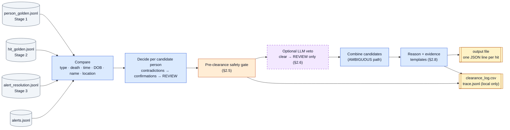
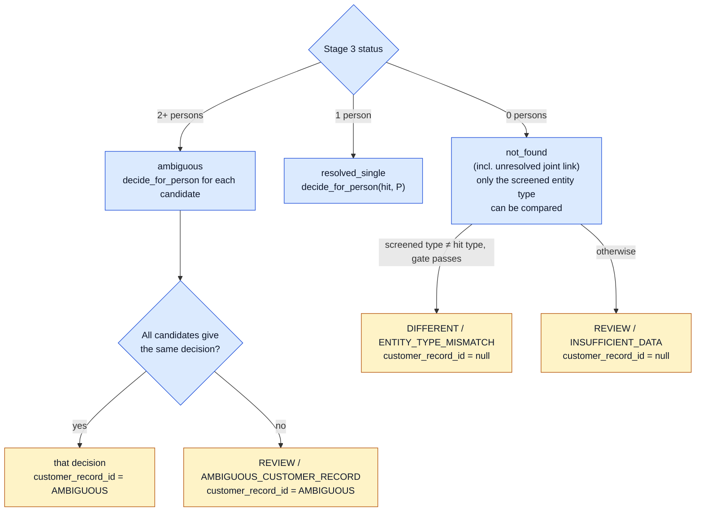
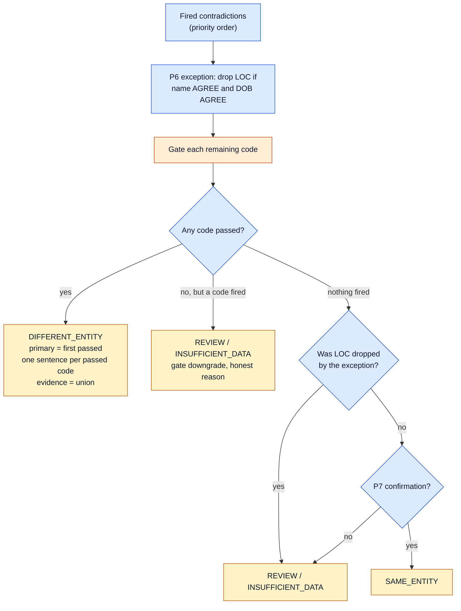

# Stage 4: Decision rules (notes)

> **Status: designed, not built.** §1 covers the alert roll-up. §2 is the full build guide for Stage 4: the decision procedure, the pre-clearance gate (including every Stage 1, 2 and 3 flag it reads), the optional LLM veto, the clearance log, reasons and evidence, tests and build order. Anyone can add to it.
>
> Part of the 4-stage architecture: **1** customer golden record · **2** hit golden profile · **3** alert → person resolution · **4** decision rules (this doc).

---

## 1. Alert roll-up

**Policy:** "An alert is cleared only when every hit in it is `DIFFERENT_ENTITY`."

The official output and the scoring are per hit, so nothing in the pipeline currently checks the alert-level result. Analysts work alerts, not hits, so we add a small deterministic step after the per-hit decisions. It writes an **alert summary into the trace only**. It never changes the official per-hit output.

### Alert status

| Status | When | What the summary lists |
|---|---|---|
| `CLEARED` | Every hit in the alert is `DIFFERENT_ENTITY` | Each hit with its reason code and fragility (a clear is only as strong as its weakest hit) |
| `ESCALATED` | At least one hit is `SAME_ENTITY` | The `SAME_ENTITY` hit(s); the alert goes to compliance |
| `NEEDS_REVIEW` | Otherwise (no `SAME_ENTITY`, at least one hit not `DIFFERENT_ENTITY`) | The **blocking hits**: each hit that stops the clear, with its code and what is missing |

`ESCALATED` takes priority over `NEEDS_REVIEW` when both apply.

### Completeness check

Before computing the status, compare the alert's `hit_ids` (from `alerts.jsonl`) with the hits we actually decided.

- A hit that is **missing** from our results, or **errored**, counts as a blocking hit with the reason `HIT_NOT_DECIDED`.
- An alert with any undecided hit can **never** be `CLEARED`. It is `NEEDS_REVIEW` (or `ESCALATED` if another hit is `SAME_ENTITY`).
- This stops a silent failure from looking like a clean alert.

### Trace shape (sketch)

```json
{
  "alert_id": "A-000001",
  "alert_status": "NEEDS_REVIEW",
  "hits": [
    {"hit_id": "H-000001", "decision": "DIFFERENT_ENTITY", "reason_code": "DOB_MISMATCH", "fragility": "solid"},
    {"hit_id": "H-000002", "decision": "REVIEW", "reason_code": "INSUFFICIENT_DATA", "missing": "no birth date on hit"}
  ],
  "blocking_hit_ids": ["H-000002"],
  "undecided_hit_ids": []
}
```

Synthetic IDs only. Written to the trace file (gitignored), one record per alert, sorted by `alert_id`.

### Tests

- All hits `DIFFERENT_ENTITY` → `CLEARED`.
- One `SAME_ENTITY` and one `REVIEW` → `ESCALATED`, both listed.
- One `REVIEW` among clears → `NEEDS_REVIEW`, that hit blocking.
- One hit missing from the results → `NEEDS_REVIEW`, `undecided_hit_ids` set, never `CLEARED`.
- The roll-up is identical across reruns (sorted, no LLM).

### UI

The overview counts alerts as well as hits (cleared, escalated, needs review). The analyst queue groups `REVIEW` hits by alert and shows the blocking hits first.

---

## 2. Stage 4 build guide

> **Status: designed, not built.** This section is a self-contained brief for the agent that builds Stage 4. Read it top to bottom before writing code. Section 1 above (alert roll-up) still stands. §2.10 says how it plugs in.
>
> **Hard rule for anything you write in this repo:** it is public. Never paste real values from `dev/` (names, record IDs, dates of birth, note text) into code, tests, docs or commit messages. Use invented fixtures like the ones in this guide (`CUS-999991`, `H-0000AA`, "Jane Example"). Aggregate counts are fine.

### 2.1 What Stage 4 does, in one paragraph

Stages 1 to 3 have already answered "who is the customer?" and "who is the listed person?". Stage 4 compares the two and, for **every hit**, writes one line: `DIFFERENT_ENTITY`, `SAME_ENTITY` or `REVIEW`, with a reason code, the customer record, a 2–4 sentence reason and the IDs of the records that decided it. It is pure rules: no free-text reading, no LLM on the default path. The only optional LLM step (§2.6) can turn a clearance into `REVIEW`, never the other way round.



### 2.2 Interface

**Command.** `system/run <data folder> <output file>` already runs Stages 1, 2 and 3 (Stage 3 merged in `9981431` and writes `alert_resolution.jsonl` to the cache). After Stage 3 it must write the per-hit decisions to `<output file>`. Today it writes a run summary JSON there (`"stage": 3`). That must change:

| Today | After Stage 4 |
|---|---|
| `<output file>` = summary JSON | `<output file>` = **one JSON line per hit**, nothing else |
| Summary printed to stdout | Summary still printed to stdout, and also written to `$SANCTIONS_CACHE/run_summary.json` |

**Inputs** (all from `$SANCTIONS_CACHE`, default `working/`, plus the data folder):

| Input | Produced by | Fields Stage 4 reads |
|---|---|---|
| `person_golden.jsonl` | Stage 1 | `person_id`, `record_ids`, `customer_record_ids`, `entity_type{value,source_id}`, `legal_name{value,parts,real_part_count,verified,method,source_id,source_kind,blocks_name_clear,may_solely_support_different_entity}`, `names_all[]`, `dob{value,precision,verified,method,source_id,may_solely_support_different_entity}`, `declared_dobs[]{value,precision,comparable,source_id}`, `incorporation_date{value,precision,verified,source_id}`, `countries[]{value,kind,source_id}` (`kind` ∈ `residence`, `nationality`, `doc_country`, `residence_note`), `flags[]`, `contracts{}` |
| `hit_golden.jsonl` | Stage 2 | `hit_id`, `alert_id`, `entity_type`, `names[]{value,kind,parts,script,source_field}`, `countries[]{value,field,unmapped}`, `dob_candidates[]{years,month,day,precision,source,source_id,method,rule,may_solely_support_different_entity}`, `dob_tier`, `incorporation_dates[]`, `deceased{life_status,date,precision}`, `earliest_dated_report{date,precision}`, `search_results.accepted[]{result_id}`, `flags[]` |
| `alert_resolution.jsonl` | Stage 3 (`system/stage3/resolve.py`) | `alert_id`, `resolution_status` (`resolved_single` / `ambiguous` / `not_found`), `resolution_quality`, `resolution_clean`, `resolution_method`, `resolution_reason`, `method`, `status` (legacy upper-case), `candidates[]{person_id,record_ids,matched_records,why,filters,fragility_flags}`, `chosen_person_ids`, `customer_record_id`, `flags[]`, `fragility_flags[]`, `evidence_ids`, `considered_ids`, `rejected_holders`, `screened`, `trace` (see §2.5.3) |
| `alerts.jsonl` | data folder | `alert_id`, `screened_at`, `customer.entity_type`, `hit_ids` |
| `hits.jsonl` | data folder | only to check that every hit gets exactly one line |

`person_golden.jsonl` is about 160 MB on dev. Don't load it all into memory. Collect the `person_id`s Stage 3 needs, then stream the file once and keep only those rows.

**Output line** (exactly `output.schema.json`; field order fixed as below; lines sorted by `hit_id`):

```json
{"hit_id": "H-0000AA", "alert_id": "A-0000A1", "decision": "DIFFERENT_ENTITY", "reason_code": "DOB_MISMATCH", "customer_record_id": "CUS-999991", "reason": "The customer's date of birth is 1990-04-02 (KYC-0000A1) but the hit's listed date of birth is 1961-07-15.", "evidence": ["KYC-0000A1"]}
```

**Deliverables Stage 4 unlocks:**

1. `system/run <dev folder> output/dev.jsonl` (the dev data folder is never committed).
2. `python3 validate.py --data <dev folder> --output output/dev.jsonl --score <dev folder>/practice_labels.jsonl` reports 0 problems.
3. `system/README.md` (§2.12).

### 2.3 Scoring maths and the strategy it implies

The brief (§6) scores each decision by cost; lower is better.

| Right answer ↓ / we said → | `DIFFERENT_ENTITY` | `SAME_ENTITY` | `REVIEW` |
|---|---|---|---|
| `DIFFERENT_ENTITY` | 0 | 3 | 3 |
| `SAME_ENTITY` | **60** | 0 | 2 |
| `REVIEW` | **60** | 2 | 0 |

Decision score = `max(0, 1 − cost / cost_if_everything_were_REVIEW)`.

**Baseline from the practice labels.** The 50 practice hits are 28 `DIFFERENT_ENTITY`, 12 `SAME_ENTITY` and 10 `REVIEW`. All-`REVIEW` costs 28 × 3 + 12 × 2 + 10 × 0 = **108**. If the unseen set (~550 hits) has the same mix, its baseline is about 108 × 11 ≈ **1,190**.

| Quantity | Value | What it means |
|---|---|---|
| Points available from clearing | 84 of 108 (78%) | Most of the decision score is earned by correct clearances |
| Points available from confirming | 24 of 108 (22%) | Confirmations matter, but less |
| Gain from one correct clearance | 3 | ≈ 0.25% of the unseen decision score |
| Loss from one unsafe clearance | 60 | ≈ 5% of the unseen decision score, the same as 20 correct clearances |
| Clear-or-review break-even | clear only if P(truly different) > 58/61 ≈ **95%** | Clearing costs 60·(1−p); reviewing costs about 3p + 2(1−p) |

**Rule 1: clear only on a clean contradiction.** A clearance must be at least ~95% safe. In practice that means a contradiction the SOP names, built only from facts read with a pattern we trust, about a customer we resolved cleanly. Anything shakier goes to `REVIEW` (§2.5).

**Rule 2: confirm boldly.** Compare `SAME_ENTITY` with `REVIEW`:

| If the truth is | `SAME` costs | `REVIEW` costs | Difference |
|---|---|---|---|
| `DIFFERENT_ENTITY` | 3 | 3 | none |
| `SAME_ENTITY` | 0 | 2 | SAME saves 2 |
| `REVIEW` | 2 | 0 | SAME loses 2 |

So `SAME_ENTITY` beats `REVIEW` whenever a true match is more likely than a true review. When name and date of birth agree under P7 and nothing contradicts, confirm. Don't add extra caution to confirmations.

**Rule 3: reasons are 25% of each set's score, and cheap.** For every right decision the organisers check the reason code, the evidence (deciding records only), the customer record and the reason text. One template per reason code, filled with this hit's own facts and citing exactly the deciding records, wins most of that 25% (§2.8).

**Rule 4: reproducibility is 10% and free if we stay deterministic.** It counts identical decision and reason code over five runs, scaled by the unseen score. The default path has no LLM, so it is byte-identical by construction (§2.11). The optional veto (§2.6) is the only thing that can put this at risk.

**Overall weights:** unseen set 80% (decisions 75 / reasons 25), dev set 10% (same split), reproducibility 10%. Some hits are not scored because the files can't settle them. Answer them anyway, and don't over-engineer the grey zone.

**Where the risk really is.** The labels follow the SOP mechanically, so the risk isn't judgement. It is (a) misreading a fact from unseen wording, and (b) resolving the alert to the wrong customer. The safety gate (§2.5) targets both.

**Dev shape, for orientation** (aggregates only):

| Measure | Dev value |
|---|---|
| Alerts / hits | 440 / 819 (344 alerts have one hit; the largest has 15) |
| Alert links | 170 account, 70 login, 54 email, 146 none |
| Hit types | 701 individual–individual, 117 company–company, 1 company alert with an individual hit |
| Individual hits with no DOB from any source | 447 of 702 |
| Hits with no country | 87 |
| Hits with a non-Latin alias | 124 |
| Deceased hits | 6 (4 dated, 2 of them to the month only) |
| Hits with at least one strict dated report | 215 |
| Company hits with an incorporation date | 0 |

The 447 undated individuals are why Stage 4 will mostly confirm or review rather than clear on DOB. Location is the workhorse clearance (18 of the 28 practice clearances accept `LOCATION_MISMATCH`, 15 of them as the only code).

### 2.4 Decision procedure

#### 2.4.1 Top level



```python
def decide_hit(hit, alert, resolution, persons_by_id):
    status = resolution["resolution_status"]        # resolved_single | ambiguous | not_found
    if status == "not_found":                        # includes an unresolved joint link
        # POLICY P9: customer_record_id is null when no customer was found.
        if type_contradicts(alert["customer"]["entity_type"], hit["entity_type"]):
            return verdict("DIFFERENT_ENTITY", "ENTITY_TYPE_MISMATCH", record=None,
                           evidence=[alert["alert_id"]])       # open question Q5
        return review_insufficient(record=None, missing="no customer record fits the alert")

    candidates = sorted(resolution["candidates"], key=lambda c: c["person_id"])
    if status == "resolved_single":
        person = persons_by_id[candidates[0]["person_id"]]
        return decide_for_person(hit, alert, person, resolution).finish(
            record=resolution["customer_record_id"])

    # ambiguous. POLICY P3: "decide the hit for each; if they all lead to the same decision,
    # give it, otherwise REVIEW with AMBIGUOUS_CUSTOMER_RECORD. Either way AMBIGUOUS."
    per = [decide_for_person(hit, alert, persons_by_id[c["person_id"]], resolution)
           for c in candidates]
    decisions = {v.decision for v in per}
    if len(decisions) == 1:
        return combine_same_decision(per, candidates).finish(record="AMBIGUOUS")
    return verdict("REVIEW", "AMBIGUOUS_CUSTOMER_RECORD", record="AMBIGUOUS",
                   evidence=candidate_records(candidates))
```

`combine_same_decision`:

- **All `DIFFERENT_ENTITY`:** the code is the highest-priority code (§2.4.9) that cleared, post-gate, for **every** candidate. If no code is shared, use the highest-priority primary code among the candidates. Evidence = every candidate's matched `CUS-` records plus each candidate's deciding records. Every candidate must have passed the gate on its own (§2.5).
- **All `SAME_ENTITY`:** the shared code if there is one, else `NAME_DOB_MATCH` for individuals or `NAME_LOCATION_MATCH` for companies. Evidence as above.
- **All `REVIEW`:** `INSUFFICIENT_DATA`. Evidence = every candidate's matched `CUS-` records plus the records each candidate's review reason cites. Both ambiguous practice labels look exactly like this: all candidate `CUS-` IDs plus a `KYC-` and a `NOTE-`.

#### 2.4.2 Deciding one hit against one person

POLICY order: entity type → time and death → date of birth → location → name (P6 contradictions), then confirmation (P7), then `REVIEW`.

```python
PRIORITY = ["ENTITY_TYPE_MISMATCH", "DECEASED", "TEMPORAL_IMPOSSIBILITY",
            "DOB_MISMATCH", "NAME_MISMATCH_VERIFIED", "LOCATION_MISMATCH"]   # §2.4.9

def decide_for_person(hit, alert, person, resolution):
    cmp = compare(hit, alert, person)        # each dimension: AGREE | CONTRADICT | UNKNOWN,
                                             # with deciding source IDs and fragility notes
    fired = [code for code in PRIORITY if cmp.contradiction(code)]

    # P6: "A country difference does not clear a hit whose name and date of birth agree:
    # that hit is REVIEW."
    location_exception = False
    if "LOCATION_MISMATCH" in fired and cmp.name == AGREE and cmp.dob == AGREE:
        fired.remove("LOCATION_MISMATCH")
        location_exception = True

    passed = [code for code in fired if gate(code, hit, person, resolution, cmp).ok]   # §2.5
    if passed:
        return different(primary=passed[0], also=passed[1:], cmp=cmp)
    if fired:
        return review_insufficient(downgraded_from=fired, cmp=cmp)       # the gate said no
    if location_exception:
        return review_insufficient(note="name and DOB agree but no country is shared", cmp=cmp)

    # P7: confirm only on agreement, and only when nothing contradicts.
    if person_type(person) == "Individual":
        if cmp.name == AGREE and cmp.dob == AGREE and cmp.location != CONTRADICT:
            code = "NAME_DOB_LOCATION_MATCH" if cmp.location == AGREE else "NAME_DOB_MATCH"
            return same(code, cmp)
    else:  # Company
        if cmp.name == AGREE and cmp.location == AGREE and cmp.dob != CONTRADICT:
            return same("NAME_LOCATION_MATCH", cmp)
    return review_insufficient(cmp=cmp)
```

Notes:

- `fired` is computed **before** the gate, so the clearance log (§2.7) can count what each gate flag cost.
- A contradiction that is gated becomes `REVIEW`, never `SAME`. A gated contradiction is still "something that contradicts" for P7.
- Location `CONTRADICT` blocks confirmation even when it can't clear (for example, when it was gated). P7 says "nothing contradicts them".

#### 2.4.3 Dates: agree, contradict, or neither (P6, P7)

Customer date `c` = `{y, m, d, precision}`. Hit candidate `h` = `{years[], month, day, precision}`. An age at a date gives `years = [Y−N−1, Y−N]` with no month or day (Stage 2 computes this).

```python
def agrees(c, h):              # P7
    if c.y not in h.years: return False
    if c.m is not None and h.month is not None and c.m != h.month: return False
    if c.d is not None and h.day is not None and c.d != h.day: return False
    return True

def contradicts(c, h):         # P6 "Date of birth"
    if min(abs(c.y - y) for y in h.years) > 1:          # more than 1 year outside
        return True
    if len(h.years) == 1 and c.y == h.years[0]:         # same year, both give a month
        if c.m is not None and h.month is not None:
            if c.m != h.month: return True
            if c.d is not None and h.day is not None and c.d != h.day: return True
    return False
```

| Customer | Hit candidate(s) | Result | Why |
|---|---|---|---|
| 1980-05-01 | 1980 | AGREE | a year agrees with a full date in that year |
| 1980-05-01 | 1980-06 | CONTRADICT | same year, months differ |
| 1980-05-01 | 1981 | neither | only 1 year apart: not a contradiction, not an agreement |
| 1980-05-01 | 1982 | CONTRADICT | more than 1 year outside |
| 1980 | 1978 or 1979 (age at date) | neither | 1979 is within 1 year |
| 1980 | 1976 or 1977 | CONTRADICT | the nearest year is 3 away |
| 1980-05-01 | 1962 and 1980 (two `dobs`) | AGREE | one agreeing date is enough to block a DOB clear |

**Dimension result.**

- `cmp.dob = AGREE` if **any** hit candidate agrees with the customer date.
- `cmp.dob = CONTRADICT` if there is at least one candidate and **every** candidate is contradicted (P6: "One agreeing date is enough to prevent this").
- `cmp.dob = UNKNOWN` otherwise: no candidates, no customer date, or the "neither" zone.

**Which customer date.**

- **Individuals:** `person.dob` when `verified` is true and `method` is not `llm` (P4: the latest approved check or KYC note). If there is no verified date of birth, a DOB contradiction needs every entry in `declared_dobs` to be comparable and to contradict (the Stage 1 review rule). Agreement can use any declared date.
- **Companies:** `person.incorporation_date` against the hit's `incorporation_dates` (P5: for companies only the `dobs` field is an incorporation date). No dev company hit has one, so this path is test-only.

**Declared dates when a verified date exists.** `contracts.dob_mismatch_only_if_every_declared_contradicts` is always true on Stage 1 rows. Read literally, a missing or unparsed declared date blocks every DOB clear. On the practice labels, **4 of the 7 hits that accept `DOB_MISMATCH` belong to persons with a non-comparable declared date, and 2 of those have no other acceptable code.** The literal rule would turn those 2 into `REVIEW` (and push the other 2 onto `NAME_MISMATCH_VERIFIED`). Implement this instead, and tell FDE (open question Q2):

- With a verified date of birth, the verified date decides (P4).
- A declared date that **agrees** with a hit candidate still blocks the clear: gate flag `DECLARED_DOB_AGREES`.
- A missing or unparsed declared date does not block.

**Don't call `shared.contracts.dob_mismatch_allowed` as is.** It treats any declared date that isn't `dates_compatible` (same year) as a contradiction. So a declared 1971 against a hit's 1970 counts as contradicting, which is looser than P6's 1-year tolerance. It also takes one raw hit value rather than candidate sets. Use the `contradicts()` above, and ask FDE to fix or retire the helper (Q3). `dates_compatible` in `stage1/normalise.py` is the right **agreement** test, but it is not the opposite of `contradicts`.

#### 2.4.4 Time and death (P6 "Time")

```python
def temporal_impossibility(person, hit):
    r = hit["earliest_dated_report"]            # strict SOP line form only (Stage 2)
    if not r: return False
    if person_type(person) == "Individual":
        c = customer_dob(person)                # same choice as 2.4.3
        if not c: return False
        oldest_birth = (c.y, c.m or 1, c.d or 1)           # earliest possible birth date
        return age_on(oldest_birth, r.date) < 16           # even the oldest reading is under 16
    inc = person["incorporation_date"]
    if not inc: return False
    earliest_inc = (inc.y, inc.m or 1, inc.d or 1)
    return earliest_inc > r.date                # incorporated strictly after the report

def deceased(hit, alert):
    d = hit["deceased"]
    if not d or not d.get("date"): return False             # DECEASED_NO_DATE never clears
    latest_death = last_possible_day(d["date"], d["precision"])   # year → 31 Dec, month → last day
    return latest_death < parse_iso(alert["screened_at"])
```

- With partial dates, compare at the coarser precision and fire only if **every** reading of the partial date gives the contradiction.
- Death comes only from the structured `life_status` / `deceased_date` fields (Stage 2 §4.5). Death words in profile notes are never used.
- If the customer has no verified date of birth, temporal impossibility needs every declared date to give "under 16". Partial or missing ones block it.

#### 2.4.5 Location (P6 "Location")

```python
C = {c["value"] for c in person["countries"]}   # residence + nationality on ALL records,
                                                 # doc country of ALL approved checks,
                                                 # residence notes. Never city.
K = {c["value"] for c in hit["countries"] if not c.get("unmapped")}
cmp.location = AGREE if C & K else (CONTRADICT if C and K else UNKNOWN)
```

- A missing country on either side is `UNKNOWN`, never a mismatch.
- Territories are their own country, and "International" and "Europe" are not countries (Stage 2 already applies both).
- The P6 exception in §2.4.2 turns a location-only contradiction into `REVIEW` when name and date of birth agree.
- Be generous on the customer side and strict about clearing. An unread note or an unmapped country blocks the clear (§2.5). It never adds a contradiction. On practice, 4 of the 10 `REVIEW` hits avoid a location clearance only because of a residence note.

#### 2.4.6 Names (P6 "Name", P8)

Use `NameTools.names_agree(left_parts, right_parts)` (exhaustive pairing, `shared/names.py`). It returns `{agree, matched_pairs, reason, exhaustive}`.

| Customer side | Used for | Rule |
|---|---|---|
| `legal_name.parts` when `legal_name.verified` and `method != "llm"` | both agreement and `NAME_MISMATCH_VERIFIED` | P4: the verified legal name outranks the record and screened names |
| Non-blocking forms in `names_all` (only when there is no verified legal name) | agreement only | cheap: a wrong confirmation costs at most 2 |
| Any form with `blocks_name_clear: true` | nothing | P8 placeholder rule |

Hit side: every entry in `hit.names` with non-empty `parts` (primary, aliases including nicknames, best-matching, structured). Non-Latin aliases have no parts and can't be compared (`NON_LATIN_ALIAS`, see §2.5).

- `cmp.name = AGREE` if the customer name agrees with **any** hit name.
- `cmp.name = CONTRADICT` only if the **verified** legal name agrees with **none** of them, every comparison was `exhaustive: true`, and the hit has at least one comparable name.
- `cmp.name = UNKNOWN` if the name is blocked, there's no comparable name, or a comparison wasn't exhaustive.
- **Short and placeholder names (P8).** An individual customer whose name has fewer than two real parts can be neither confirmed nor cleared on name, so `cmp.name = UNKNOWN`. The flags are `NAME_TOO_SHORT`, `BLOCK_NAME_CLEAR` and `PLACEHOLDER_NAME`, on 190 dev persons. A hit's **single-part alias** can still agree with a customer name that has two or more real parts.
- **Companies.** Legal forms from `name_variants.json` are not name parts. Stages 1 and 2 already drop them. The placeholder rule is for individuals only.
- **Order independence.** Stage 3 already ships `stage3.names.agree_symmetric`; prefer it (or FDE's symmetric tie-break when it lands in `shared/names.py`). Otherwise compute both `names_agree(a, b)` and `names_agree(b, a)`. If they differ, treat the name as `UNKNOWN` for clearing (gate flag `NAME_ORDER_DEPENDENT`) and as `AGREE` for confirming.

#### 2.4.7 Entity type (P6 "Type")

- Customer type is `person.entity_type.value`. If that is null (`TYPE_CONFLICT`), the dimension is `UNKNOWN`.
- `CONTRADICT` only when both sides are in {`Individual`, `Company`} and they differ.
- If the screened type on the alert disagrees with the resolved person's type, don't fire (gate flag `SCREENED_TYPE_DISAGREES`).
- Entity-type mismatch is the one contradiction allowed when no customer was found. Then it compares the **screened** type with the hit (§2.4.1).

#### 2.4.8 Links that contradict the screened details

The SOP says "follow whatever link the alert carries" (P2). Stage 3 still follows a link whose customer contradicts the screened name or date of birth, and flags it (`LINK_SUSPECT` / `link_contradicts_screened`). Stage 4 decides as normal, but the gate turns any clearance on such an alert into `REVIEW`. Confirmations are unaffected. Dev has none of these, so they are test-only.

#### 2.4.9 Reason-code priority

POLICY says "When several apply, any of them is accepted", and the practice labels list every acceptable code (for example `[DOB_MISMATCH, NAME_MISMATCH_VERIFIED]`). So the choice only matters when we fire a code the labeller didn't. To minimise that, pick the most robust code that passed the gate:

| Rank | Code | Why this rank |
|---|---|---|
| 1 | `ENTITY_TYPE_MISMATCH` | two structured fields |
| 2 | `DECEASED` | structured death field + alert date |
| 3 | `TEMPORAL_IMPOSSIBILITY` | strict SOP line form + verified DOB |
| 4 | `DOB_MISMATCH` | verified DOB; cites one record |
| 5 | `NAME_MISMATCH_VERIFIED` | verified name; cites one record; depends on the fuzzy rules |
| 6 | `LOCATION_MISMATCH` | depends on every note being read; cites the most records |

For `SAME_ENTITY`, use `NAME_DOB_LOCATION_MATCH` when a country is shared and `NAME_DOB_MATCH` otherwise. All 8 individual practice confirmations accept both. Companies always get `NAME_LOCATION_MATCH`. For `REVIEW`, use `INSUFFICIENT_DATA` except in the ambiguous split case.

This differs from `docs/explainability-and-reproducibility.md` §3 ("first in POLICY table order"). Both orders are deterministic and both pass the labels. Update that doc when this is built (Q4).

### 2.5 Pre-clearance safety gate

**Principle:** missing, unread, unmapped, fuzzy or LLM-read evidence can **block** a clearance, and never **cause** one.

- The gate runs per fired code, so a blocked `LOCATION_MISMATCH` can still let a clean `DOB_MISMATCH` through.
- If every fired code is blocked, the hit becomes `REVIEW / INSUFFICIENT_DATA`.
- The gate never touches `SAME_ENTITY` or `REVIEW` decisions, except the name-blocking rules that also apply to confirmations (marked ✱).

Codes in the "Blocks" columns:

- **TYPE** `ENTITY_TYPE_MISMATCH` · **DEC** `DECEASED` · **TEMP** `TEMPORAL_IMPOSSIBILITY`
- **DOB** `DOB_MISMATCH` · **NAME** `NAME_MISMATCH_VERIFIED` · **LOC** `LOCATION_MISMATCH`
- **ALL-C**: every code that uses customer facts. That is TEMP, DOB, NAME and LOC, plus TYPE unless the screened type on its own differs from the hit.

Status: ✅ exists on `main` · ⏳ pending fix (owner named) · 🆕 Stage 4 computes it · Stage 3 rows (§2.5.3) come from the merged `system/stage3` code.

#### 2.5.1 Customer side (Stage 1, `person_golden`)

| Flag / field | Blocks | Status | Dev persons |
|---|---|---|---|
| `contracts.block_name_mismatch_verified` / `BLOCK_NAME_MISMATCH_VERIFIED` / `UNVERIFIED` / `legal_name.verified == false` | NAME | ✅ | 3 |
| `contracts.block_name_clear` / `BLOCK_NAME_CLEAR` / `NAME_TOO_SHORT` / `PLACEHOLDER_NAME`, and any `names_all[].blocks_name_clear` form | NAME, and ✱ name-based confirmation | ✅ | 190 (172 with a placeholder) |
| `contracts.block_dob_age_name_clear` / `BLOCK_DOB_AGE_NAME_CLEAR` (a verification-like note that didn't fully parse) | DOB, TEMP, NAME | ✅ | 3 |
| `contracts.block_location_mismatch` / `BLOCK_LOCATION_MISMATCH` / `UNMAPPED_COUNTRY` / any `NOTE_FLAGGED:*` | LOC | ✅ | 4 |
| `MULTI_VERIFICATION_CONFLICT` (approved checks disagree on identity) | DOB, TEMP, NAME | ✅ | 0 |
| `TYPE_CONFLICT` (records disagree on type) | TYPE | ✅ | 0 |
| `UNPARSED_DATE` on the person | DOB, TEMP | ✅ | — |
| `legal_name.method == "llm"` or `may_solely_support_different_entity == false` | NAME | ✅ | 0 (LLM off) |
| `dob.method == "llm"` or `dob.may_solely_support_different_entity == false` | DOB, TEMP | ✅ | 0 (LLM off) |
| No verified DOB, and not every `declared_dobs` entry is comparable and contradicting | DOB, TEMP | ✅ contract / 🆕 check | — |
| `DECLARED_DOB_AGREES`: a declared date agrees with a hit candidate although the verified date contradicts it | DOB | 🆕 | measure |
| A KYC note that records a negative outcome (rejected or failed check) must not count as an approved check | DOB, TEMP, NAME (through a wrong verified fact) | ⏳ FDE | — |

#### 2.5.2 Hit side (Stage 2, `hit_golden`)

| Flag / field | Blocks | Status | Dev hits |
|---|---|---|---|
| `NOTE_DOB_UNRESOLVED` (a birth or age cue regex couldn't resolve) | DOB | ✅ | 0 |
| `UNPARSED_DATE` / `UNKNOWN_DATE` from `dobs`, later `DOBS_UNPARSED` | DOB | ✅ / ⏳ FDE (`DOBS_UNPARSED` will also stop the search-result fallback) | 0 |
| A candidate with `rule_strength: "weak"` (age rules FDE marks as weak) | DOB, if that candidate is one of the contradicted ones | ⏳ FDE | — |
| Case-insensitive "born" / "date of birth" cue (FDE fix). Until it lands: a DOB that came from search results while the first paragraph contains "born" or "date of birth" in any case | DOB | ⏳ FDE / 🆕 interim check | — |
| Any deciding fact with `method == "llm"` or `may_solely_support_different_entity == false`. An LLM fact may never contribute to a clearance | every code it would feed | ✅ field / 🆕 check | 0 (LLM off) |
| `LLM_UNKNOWN`, `LLM_SKIPPED_BUDGET` | DOB | ✅ | 0 |
| `MULTI_SR_CONFLICT` (accepted search results disagree on the year) | DOB | ✅ (recommended gate) | 0 |
| Any name comparison with `exhaustive: false` | NAME. The P6 location exception is also assumed to hold, so LOC is blocked when DOB agrees | ✅ field / 🆕 check | measure |
| `NAME_ORDER_DEPENDENT` (§2.4.6), until the symmetric tie lands | NAME | 🆕 interim / ⏳ FDE | measure |
| Hit country with `unmapped: true` (`UNMAPPED_COUNTRY`) | LOC | ✅ | 0 after the new mappings |
| `NON_LATIN_ALIAS` | NAME, **decided with the clearance log** (below) | ✅ flag / 🆕 decision | 124 |
| `DECEASED_NO_DATE`, `NO_COUNTRY`, `NO_DOB` | Not gates: the contradiction simply can't fire | ✅ | 2 / 87 / 564 |

**`NON_LATIN_ALIAS`.** 124 dev hits carry an alias in a non-Latin script, which we can't compare and don't transliterate. A `NAME_MISMATCH_VERIFIED` on such a hit assumes the unread alias doesn't spell the customer's name. Stage 2 found that on dev every non-Latin alias also has a Latin form in the profile, which argues for not blocking. Decide with numbers:

1. Run with the flag **blocking NAME** (the cautious default).
2. In the clearance log, count the NAME-only clearances it removes (hits where NAME was the only code that passed).
3. If that count is small (each costs at most 3), keep blocking. If it is large and none of the affected hits is practice-labelled `REVIEW` or `SAME`, relax the rule to "block NAME only when the hit has fewer Latin names than non-Latin aliases". Record the decision in the README.

#### 2.5.3 Alert side (Stage 3, `alert_resolution.jsonl`)

Stage 3 is merged (`9981431`). The contract is the real code in `system/stage3/resolve.py`, not the earlier design doc. On dev: 440 alerts, 413 `resolved_single`, 27 `ambiguous`, 0 `not_found`.

**Top-level fields Stage 4 uses:**

| Field | Values (dev count) | Meaning for Stage 4 |
|---|---|---|
| `resolution_status` | `resolved_single` (413), `ambiguous` (27), `not_found` (0) | which branch of §2.4.1. `not_found` covers no survivor and an unresolved joint link (`resolution_reason: unresolved_joint_link`) |
| `resolution_quality` | `clean_link` (236), `unique_search_match` (119), `joint_account_pick` (58), plus `ambiguous`, `not_found`, `LINK_SUSPECT`, `DANGLING_LINK_fallback` | how the person was found. Not the same as `resolution_clean` |
| `resolution_clean` | true on 307 alerts | `resolved_single` **and** no fragility flag on any candidate. Only a statement about the resolution, not the hit |
| `fragility_flags` (top level = union of `candidates[].fragility_flags`) | `candidate_kept_on_missing_field` (128), `joint_account_tiebreak` (58), `dob_partial_only` (32), `name_match_fuzzy_only` (2), `resolved_via_note_country` (0), `link_contradicts_screened` (0) | resolution fragility (below) |
| `flags` | `DANGLING_LINK`, `RECORD_DOB_MISSING_KEPT`, `NAME_TOO_SHORT` (screened name) | see below |
| `candidates[]` | `person_id`, `record_ids`, `matched_records`, `why`, `filters{applied,passed,skipped_missing}`, `fragility_flags` | one per candidate person, sorted |
| `customer_record_id` | a `CUS-` id, `AMBIGUOUS` or null | use as is (§2.8.3) |
| `evidence_ids` / `considered_ids` | deciding ids (surviving records, plus the `ACC-` id for account links) / ids only looked at | **do not copy into output evidence**: labels never cite `ACC-` ids. Use the surviving `CUS-` ids only where §2.8.2 says CUS records are cited (AMBIGUOUS) |

**Gate rows:**

| Stage 3 signal | Blocks | Default and how to tune |
|---|---|---|
| `resolution_quality == "LINK_SUSPECT"` or fragility `link_contradicts_screened` | ALL-C | hard; never relax (Stage 3 docstring: "Stage 4 must not clear it") |
| `resolution_quality == "DANGLING_LINK_fallback"` / flag `DANGLING_LINK` | ALL-C | hard |
| `name_match_fuzzy_only` (2) | ALL-C | hard; the real customer may have been missed |
| `resolved_via_note_country` (0) | ALL-C | hard |
| `joint_account_tiebreak` (58) | ALL-C (cautious default) | **measure**: all 8 joint-account practice alerts pick the right holder. If the clearance log shows it blocks many solid clearances, relax to "block only if the rejected holder's name also agrees with the hit" |
| `candidate_kept_on_missing_field` (128) / flag `RECORD_DOB_MISSING_KEPT` | ALL-C (cautious default) | **measure**: SOP says unknown is not a mismatch, so a kept candidate is policy-correct. Relax to "block only DOB/TEMP when the skipped filter was `dob`, and LOC when it was `country`" if the cost is high |
| `dob_partial_only` (32) | DOB, TEMP (cautious default) | measure; the screened DOB matched only at year or month precision |
| flag `NAME_TOO_SHORT` (screened name) | NAME | hard |
| `resolution_status == "ambiguous"` | clear only if **every** candidate clears post-gate (§2.4.1) | hard |
| `resolution_status == "not_found"` | everything except TYPE on the screened type | hard |

**Caveat: `resolution_clean` is not a green light for the hit.** It is computed from Stage 3 fragility only. It ignores Stage 1 person flags: `NAME_TOO_SHORT` appears on 16 of the 236 `clean_link` alerts and 20 of the 307 `resolution_clean` alerts. Stage 3 keeps it that way on purpose, so the clearance log can show which check blocked a clear. So Stage 4 must always run the §2.5.1 person checks (`BLOCK_*`, `NAME_TOO_SHORT`, `UNVERIFIED`, `UNMAPPED_COUNTRY`, `NOTE_FLAGGED:*`, …) and the §2.5.2 hit checks before any clearance, whatever `resolution_clean` says. `resolution_clean == false` blocks; `resolution_clean == true` permits nothing on its own.

Implement the Stage 3 gate on the per-candidate `fragility_flags` (each AMBIGUOUS candidate is gated on its own flags), plus the top-level `flags` and `resolution_quality`. Change one row at a time, with clearance-log numbers in the PR.

#### 2.5.4 Cross-cutting checks (always on)

| Check | Blocks |
|---|---|
| Every deciding fact has `method` ∈ {`field`, `regex`, `record`}, never `llm` | the code it feeds |
| Every evidence ID exists in the data folder and belongs to this hit or the resolved person's own records. It is never another customer's record, a rejected or expired check, or a rejected search result | the code it feeds |
| A clearance cites no customer-side record (except TYPE and DEC) | that code |
| `hit_id` missing from Stage 2, or the alert missing from Stage 3 | everything: `REVIEW`, and `HIT_NOT_DECIDED` in the roll-up |

```python
def gate(code, hit, person, resolution, cmp):
    reasons = []
    for flag in GATE_TABLE:                      # one entry per table row above, kept as data
        if code in flag.blocks and flag.present(hit, person, resolution, cmp):
            reasons.append(flag.name)
    return GateResult(ok=not reasons, reasons=sorted(reasons))
```

Keep the gate table in one module as data (`stage4/gate.py`). Then the clearance log can switch off a single flag to measure it (`--gate-off FLAG`, local only, never the default).

### 2.6 Optional LLM veto

**What it may do:** read the customer's notes and the hit's profile, and point out a country or date that **undermines a clearance**. It can turn `DIFFERENT_ENTITY` into `REVIEW`. It can never create a clearance, change a confirmation, or change the reason code of a decision it doesn't veto.

**When it runs:** only on hits that passed the gate as `DIFFERENT_ENTITY` with LOC, DOB or TEMP. Never for TYPE or DEC, which come from structured fields.

**Switches and budget.**

- Off by default. It runs only when the master switch `SANCTIONS_LLM=1` **and** `USE_LLM_VETO=1` are set and `OPENROUTER_API_KEY` is present.
- Use `shared/llm_client.py`: pinned free model and provider, `allow_fallbacks: false`, temperature 0, fixed seed, strict JSON schema, verbatim quote check, 3 identical calls.
- Fixed budget: at most `VETO_MAX_HITS` (default 40) hits × 3 calls per run. Spend it in a fixed order: most fragile clearances first (by the §2.7 fragility score, descending), then by `hit_id`.
- Hits beyond the budget get no veto and are logged `veto_skipped: budget`. Their clearance is exactly what the LLM-off run gives, because the veto can only remove clearances.
- Memo cache within a run, keyed by sha256(model, prompt version, input text). An optional on-disk cache can speed up local dev runs. The judges' machine won't have it, so reproducibility must not rely on it.

**Prompt shape** (version it, and hash it in the run header):

```text
SYSTEM: You check one fact for a bank's identity review. Reply with JSON only, matching the schema.
Quote text exactly as written. If nothing applies, return {"found": false}.

USER:
We plan to clear a watchlist hit because: <one templated sentence, e.g.
  "every country tied to the customer (Ireland, Portugal) differs from every country tied to the hit (Canada)"
  or "the customer's birth year 1990 is more than one year from every birth year the hit gives (1961)">.

Find ONLY a place where the customer lived or is a national of, or a birth date or age of the
customer or of the listed person, that the text states and that is NOT already listed above.

CUSTOMER NOTES (verbatim, one per line, prefixed by note id):
NOTE-0000B1: ...
HIT PROFILE, FIRST PARAGRAPH (verbatim):
...

SCHEMA: {"found": bool, "kind": "customer_country" | "hit_country" | "customer_dob" | "hit_dob",
         "source_id": string, "quote": string}
```

**Validation** (all deterministic, all in our code):

1. The three calls return the identical object; otherwise there is no veto.
2. `quote` appears verbatim in the text of the named `source_id`; otherwise no veto.
3. Our parsers (the Stage 1 country table, or `parse_date` plus the Stage 2 age rule) re-read the value **from the quote**. If they can't, there is no veto.
4. Re-run the dimension with the new value. Veto only if the contradiction no longer holds: the new country is in the other side's set, or the new date agrees or falls in the "neither" zone.

A vetoed hit becomes `REVIEW / INSUFFICIENT_DATA`. Its reason says "a note may mention a further country, so the hit is left for review", without quoting the note, and its evidence cites the note ID. The step's `llm_used` flag (from the explainability doc) is set.

**Keep it only if** on dev it vetoes at least one clearance a human agrees was unsafe, gives 0 flips across 5 runs, and stays inside the 30-minute budget under free-model rate limits. Otherwise leave it off and say so in the README.

### 2.7 Clearance log (tuning instrument)

Each run writes `$SANCTIONS_CACHE/clearance_log.csv`, a local file that is gitignored because it holds dev IDs. It has **one row per fired contradiction per (hit, candidate person)**, whether or not the gate passed it, plus a `clearance_summary.json`.

| Column | Content |
|---|---|
| `hit_id`, `alert_id`, `person_id` | keys (`person_id` is internal; local file only) |
| `resolution_status`, `resolution_method`, `resolution_clean` | from Stage 3 |
| `code` | the fired contradiction |
| `is_primary` | 1 if it was the code we emitted |
| `final_decision`, `final_code` | after the gate, the veto and the ambiguity combination |
| `gate_passed` | 1 / 0 |
| `gate_flags` | the flags that blocked this code, sorted and `;`-joined |
| `sole_blocker` | the flag, if exactly one flag blocked it (its marginal cost) |
| `frag_note_only_country` | 1 if any deciding customer country came only from a `residence_note` |
| `frag_sentence_dob` | 1 if a deciding hit DOB came from a profile-note sentence (`born`, `age_at_date`, `record_as_of`) |
| `frag_search_result_dob` | 1 if a deciding hit DOB came from a search result |
| `frag_fuzzy_name` | 1 if a name agreement or disagreement depended on an edit-distance or variant pair, or was a near miss (one part matched, or the edit distance was one above the limit) |
| `frag_partial_date_edge` | 1 if the DOB contradiction is exactly 2 years (just outside the tolerance) or rests on a month or day difference |
| `frag_single_source` | 1 if the contradiction rests on one record |
| `fragility` | `solid` / `thin` / `borderline`, as defined in the explainability doc |
| `llm_used`, `veto` | `0`/`1`; `none` / `vetoed` / `skipped_budget` |
| `evidence_n` | number of evidence IDs |
| `label_decision`, `label_codes`, `unsafe` | filled for the 50 practice hits only. `unsafe=1` if we cleared a hit whose label isn't `DIFFERENT_ENTITY` |

`clearance_summary.json` holds, per `code`: `fired`, `passed`, `primary`, `blocked_by[flag]`, `sole_blocked_by[flag]`, `fragile[frag_*]`, `on_practice` and `unsafe_on_practice`. Overall, it holds the hit count, decisions by type, the review rate and the estimated practice decision score.

**How to use it.**

- A gate flag's cost is about `3 × sole_blocked_by[flag]`. Its benefit is the unsafe clearances it prevents. Practice can show those only for the 50 labels, so judge the rest by fragility.
- Relax a flag only when its cost is high **and** the clearances it blocks are mostly `solid`.
- Tighten when a fragile column is large for a code, for example many `LOCATION_MISMATCH` clearances with `frag_note_only_country`.
- Change one flag per run, and record the before and after in the PR.

### 2.8 Reasons and evidence

#### 2.8.1 Reason templates

The `reason` field is always a filled-in template, never LLM prose:

- 2–4 sentences, using this hit's own facts, with the primary ground first.
- If several codes passed the gate, add one sentence for each further ground, up to 4 sentences in total.

The practice labels do exactly this, and their evidence covers every ground they mention.

**How to phrase the hit's DOB** (from `dob_candidates[].source`):

| Source | Phrase |
|---|---|
| `dobs` | "the hit's listed date of birth is {date}" |
| `profile_note` | "the hit's profile notes put its birth year at {y1} or {y2}" (or "at {date}" for a born-on date) |
| `search_result` | "the hit's search results put its birth year at {y1} or {y2}" |

When there are several candidates, join them with ", ", and write an age-at-date pair as "{y1} or {y2}".

| Code | Template |
|---|---|
| `ENTITY_TYPE_MISMATCH` | "The customer is {a company / an individual} ({src}) but the hit is {an individual / a company}." |
| `DECEASED` | "The hit's profile gives a date of death of {death}, before the customer was screened on {screened_at}." |
| `TEMPORAL_IMPOSSIBILITY` (person) | "The customer was born in {year} ({src}), so they were at most {max_age} when the hit's profile reports activity on {report_date}." |
| `TEMPORAL_IMPOSSIBILITY` (company) | "The customer was incorporated on {inc} ({src}), after the hit's profile reports activity on {report_date}." |
| `DOB_MISMATCH` | "The customer's date of birth is {dob} ({src}) but {hit-DOB phrase}." |
| `NAME_MISMATCH_VERIFIED` | "The customer's verified name is {legal_name} ({src}), which does not match the hit's name {hit primary name}." |
| `LOCATION_MISMATCH` | "The customer is linked only to {C, sorted, comma-joined} but the hit is linked only to {K, sorted}." |
| `NAME_DOB_LOCATION_MATCH` | "The customer's date of birth {dob} ({src}) agrees with the hit's {hit years}. Both the customer and the hit are linked to {C∩K}. The customer's name agrees with the hit's name {matched hit name}." |
| `NAME_DOB_MATCH` | DOB sentence + name sentence + "The hit gives no country to compare." (or "The customer has no country on record.") |
| `NAME_LOCATION_MATCH` | "Both the customer and the hit are linked to {C∩K}. The customer's name agrees with the hit's name {matched hit name}." |
| `INSUFFICIENT_DATA` (nothing settles it) | "{agreeing facts, one sentence each}. Nothing in the customer's records contradicts the hit, and {what is missing: 'the hit gives no date of birth' / 'the customer's date of birth is within a year of the hit's' / 'the customer's name has too few real parts to compare'}, so the hit can be neither cleared nor confirmed." |
| `INSUFFICIENT_DATA` (gate downgrade) | "{the contradiction sentence}. However, {gate reason in words, e.g. 'one of the customer's notes could not be read for countries' / 'the customer was matched only through a spelling variant'}, so the hit is left for review." |
| `INSUFFICIENT_DATA` (no customer) | "No customer record fits the screened details of this alert, so the hit cannot be compared with the customer." |
| `INSUFFICIENT_DATA` (ambiguous, all review) | "{n} different customers fit this alert ({CUS ids}). For each of them {missing fact}, so the hit can be neither cleared nor confirmed." |
| `AMBIGUOUS_CUSTOMER_RECORD` | "{n} different customers fit this alert ({CUS ids}). The hit would be {decision A} for {CUS-a} but {decision B} for {CUS-b}, so it is left for review." |

**Honesty rules.**

- Always name what is missing.
- Never call a fact verified unless `verified` is true.
- Never present a search-result date as the hit's listed date.
- Give dates at the precision we have (`1980`, `1980-05`, `1980-05-01`). The practice reference reasons show full dates, while the explainability doc prefers coarser public values (Q6).

#### 2.8.2 Evidence rules

Cite **only the records that decided the hit**, exactly as the practice labels do, sorted and de-duplicated:

| Fact used | Cite |
|---|---|
| Customer verified DOB, legal name or document country | the `KYC-…` check or `NOTE-…` verification note it came from (`source_id`) |
| Hit DOB from search results | every accepted `SR-…` that supplied a deciding candidate |
| Hit DOB from `dobs` or profile notes | nothing (labels never cite hit fields) |
| A customer country from a residence note | that `NOTE-…` |
| A customer country from residence or nationality | the `CUS-…` record(s) carrying it |
| `LOCATION_MISMATCH` | **every** customer country source: all `CUS-` records with a residence or nationality, all `KYC-`/`NOTE-` with a document country, and all residence `NOTE-`s. "Every country differs" depends on all of them |
| Location **agreement** (SAME, REVIEW) | only the sources of the **shared** countries |
| `ENTITY_TYPE_MISMATCH` | the `CUS-` record carrying the type (`entity_type.source_id`); for NOT_FOUND, see Q5 |
| `DECEASED` | see Q5 (default: the `alert_id`, the source of the screening date) |
| AMBIGUOUS (any outcome) | every candidate's matched `CUS-` records plus each candidate's deciding records |

Never cite hit IDs, `H-…#field` tokens, hit profile notes, rejected or expired checks, rejected search results, or everything that was looked at.

The practice pattern to match:

- `DOB_MISMATCH` on its own cites just the KYC or NOTE, plus the SR if there is one.
- `LOCATION_MISMATCH` cites the CUS records plus the KYC and/or NOTE.
- A `REVIEW` whose only shared country came from a residence note cites just that note.

#### 2.8.3 `customer_record_id`

| Stage 3 `resolution_status` | Value |
|---|---|
| `resolved_single` via a link | the linked record (for a joint account, the holder that fits) |
| `resolved_single` via name search | the smallest matching `CUS-` ID (any record of the person is accepted) |
| `ambiguous` | `"AMBIGUOUS"` (for every outcome) |
| `not_found` | `null` |

Never output a `P-` ID. Use the Stage 3 value or `contracts.customer_record_id_for_output`, and check it against `^CUS-[0-9]{6}$`.

#### 2.8.4 Worked examples (fictional, one per code)

All IDs, names and dates below are invented.

| # | Situation | Output |
|---|---|---|
| 1 | Customer "Jane Example" (KYC-0000A1, born 1990-04-02, linked to Ireland). The hit lists `dobs` 1961-07-15. | `DIFFERENT_ENTITY` / `DOB_MISMATCH` / `CUS-999991` / "The customer's date of birth is 1990-04-02 (KYC-0000A1) but the hit's listed date of birth is 1961-07-15." / `["KYC-0000A1"]` |
| 2 | Customer "Jane Example" has records CUS-999991 (resides in Ireland) and CUS-999992 (national of Portugal), and doc country Ireland on KYC-0000A1. The hit is linked only to Canada. Name agrees; the hit has no DOB. | `DIFFERENT_ENTITY` / `LOCATION_MISMATCH` / `CUS-999991` / "The customer is linked only to Ireland, Portugal but the hit is linked only to Canada." / `["CUS-999991","CUS-999992","KYC-0000A1"]` |
| 3 | Customer born 2009-01-10 (KYC-0000A2). The hit's earliest dated report is "According to Example Regulator; March 03, 2021: …". | `DIFFERENT_ENTITY` / `TEMPORAL_IMPOSSIBILITY` / "The customer was born in 2009 (KYC-0000A2), so they were at most 12 when the hit's profile reports activity on 2021-03-03." / `["KYC-0000A2"]` |
| 4 | Verified name "SAMIRA EXAMPLE" (NOTE-0000B1). The hit is "Example, Oliver Fictional". Only one part matches, and the shorter name isn't fully covered. | `DIFFERENT_ENTITY` / `NAME_MISMATCH_VERIFIED` / "The customer's verified name is SAMIRA EXAMPLE (NOTE-0000B1), which does not match the hit's name Example, Oliver Fictional." / `["NOTE-0000B1"]` |
| 5 | The alert and customer CUS-999993 are a company ("Example Trading Ltd"). The hit is an individual. | `DIFFERENT_ENTITY` / `ENTITY_TYPE_MISMATCH` / "The customer is a company (CUS-999993) but the hit is an individual." / `["CUS-999993"]` |
| 6 | The hit's `life_status` is Deceased, `deceased_date` 2018-06. The alert was screened on 2026-02-01. | `DIFFERENT_ENTITY` / `DECEASED` / "The hit's profile gives a date of death of 2018-06, before the customer was screened on 2026-02-01." / evidence per Q5 |
| 7 | Customer born 1975-09-30 (KYC-0000A3), linked to Portugal (CUS-999994). The hit's profile says "aged 45 in May 2021" and links it to Portugal. Names agree. | `SAME_ENTITY` / `NAME_DOB_LOCATION_MATCH` / "The customer's date of birth 1975-09-30 (KYC-0000A3) agrees with the hit's 1975 or 1976. Both the customer and the hit are linked to Portugal. The customer's name agrees with the hit's name John Sample." / `["CUS-999994","KYC-0000A3"]` |
| 8 | As example 7, but the hit has no country. | `SAME_ENTITY` / `NAME_DOB_MATCH` / "The customer's date of birth 1975-09-30 (KYC-0000A3) agrees with the hit's 1975 or 1976. The customer's name agrees with the hit's name John Sample. The hit gives no country to compare." / `["KYC-0000A3"]` |
| 9 | Company "Example Trading Ltd" (CUS-999993, Ireland, registry extract KYC-0000A4). The hit is "Example Trading Limited", Ireland. | `SAME_ENTITY` / `NAME_LOCATION_MATCH` / "Both the customer and the hit are linked to Ireland. The customer's name agrees with the hit's name Example Trading Limited." / `["CUS-999993","KYC-0000A4"]` |
| 10 | Name agrees. Ireland is shared only through NOTE-0000B2 ("lived in Ireland 2015–2020"). The hit has no DOB. | `REVIEW` / `INSUFFICIENT_DATA` / "Both the customer and the hit are linked to Ireland. The customer's name agrees with the hit's name Jane Example. Nothing in the customer's records contradicts the hit, and the hit gives no date of birth, so the hit can be neither cleared nor confirmed." / `["NOTE-0000B2"]` |
| 11 | No link. Two persons fit (CUS-999995 and CUS-999996). The hit's DOB agrees with CUS-999995's verified DOB (KYC-0000A5) but contradicts CUS-999996's (KYC-0000A6). | `REVIEW` / `AMBIGUOUS_CUSTOMER_RECORD` / `AMBIGUOUS` / "2 different customers fit this alert (CUS-999995, CUS-999996). The hit would be the same person for CUS-999995 but a different person for CUS-999996, so it is left for review." / `["CUS-999995","CUS-999996","KYC-0000A5","KYC-0000A6"]` |
| 12 | As example 2, but the customer has a support note whose places didn't parse (`BLOCK_LOCATION_MISMATCH`). | `REVIEW` / `INSUFFICIENT_DATA` / "The customer is linked only to Ireland, Portugal but the hit is linked only to Canada. However, one of the customer's notes could not be read for countries, so the hit is left for review." / `["CUS-999991","CUS-999992","KYC-0000A1"]` |

### 2.9 How contradictions, the gate and confirmation fit together



### 2.10 Alert roll-up (integration with §1)

§1 above is the spec. Build it as written, as `stage4/rollup.py`, after all the per-hit lines exist. Stage 4 adds only these:

- The roll-up's `fragility` comes from the clearance log's `fragility` column for the emitted code.
- `missing` for a blocking `REVIEW` hit is the "what is missing" clause of its reason template (§2.8.1), or the gate reason for a downgrade.
- `HIT_NOT_DECIDED` is set when a hit in `alerts.jsonl` has no Stage 2 profile or no Stage 3 row. Stage 4 still writes a `REVIEW / INSUFFICIENT_DATA` line for that hit, so the output always has exactly one line per hit.
- The roll-up goes to the local trace only (`TRACE_PATH`). It never changes `<output file>`.

### 2.11 Determinism and the time budget

| Rule | How |
|---|---|
| Hash seed | `system/run` sets `PYTHONHASHSEED=0`. If it isn't already set, the script re-execs itself with it set before importing anything |
| Ordering | Iterate hits by `hit_id`, alerts by `alert_id` and candidates by `person_id`; sort countries and evidence. Never iterate a `set` or `dict` into output without `sorted()` |
| Output | `json.dumps(line, ensure_ascii=False)` with the fixed key order of §2.2, `\n` line endings, UTF-8, sorted by `hit_id` |
| No volatile data | No timestamps, run IDs, durations or absolute paths in output lines. Those go in the run header and summary only |
| Text | Templates only; numbers formatted by fixed rules (years as integers, no floats) |
| LLM | Off by default. With the veto on, a fixed budget and order (§2.6) |
| Proof | Two consecutive runs, then `cmp` the output files byte for byte. A test does this on a synthetic fixture, and the PR reports it on dev |

**Time.** On dev, Stage 1 takes about 22–25 s and Stage 2 under 1 s. Stage 3 is index-blocked. Stage 4 should add under 30 s: stream `person_golden.jsonl` once, and compare names only against candidate persons. The whole run must stay well under 30 minutes on the unseen set, even with the veto on. The veto's time is bounded by `VETO_MAX_HITS × 3 × timeout`.

### 2.12 `system/README.md` (brief §5.3)

Replace the placeholder. The judges read it and question finalists on it. It must cover:

1. **Architecture.** The 4-stage diagram (Stage 1 customer golden record → Stage 2 hit golden profile → Stage 3 alert resolution → Stage 4 decisions), with the artefact names.
2. **How we find the customer.** Following links, the joint-account pick, the name search cascade, merging records into one person (phone + same DOB, or the same document number on approved checks), and the AMBIGUOUS path.
3. **How we find the listed person.** Names and aliases, countries, the DOB tiers (field → first paragraph → search results with the listing phrase + a country), dated reports, and death.
4. **Evidence.** Every fact carries its `source_id`, and only the deciding records are cited (the table in §2.8.2).
5. **Determinism.** §2.11, plus the two-run `cmp` result.
6. **Model and prompts.** "No LLM on the default path." If the veto or a note fallback is enabled, name the model, provider, prompt versions and guardrails (3 votes, verbatim quote, LLM facts never clear).
7. **Time and cost.** The measured dev run time per stage, and $0 LLM cost by default.
8. **Safety gate.** The flag table in short, and its measured cost from the clearance log.
9. **Three worked cases** with invented IDs: a clear mismatch (like example 1 or 2), a match (example 7) and a review (example 10 or 12), each traced from alert to output line.
10. **Honest limitations.** What we can't read (non-Latin aliases, unseen note wording), and that we review rather than guess.

### 2.13 Tests and acceptance criteria

**Acceptance (all required before merge):**

| # | Criterion |
|---|---|
| A0 | The repo has **no CI**. Run locally and paste the results into the PR: `cd system && python3 -m unittest discover -s tests` (all pass, including the existing Stage 1–3 tests), then `system/run <dev folder> output/dev.jsonl` |
| A1 | `validate.py --data <dev> --output output/dev.jsonl --score <dev>/practice_labels.jsonl` reads 819 lines with **0 problems** |
| A2 | Practice: **50/50 right decisions**, and every reason code is one of the label's `reason_codes` |
| A3 | Practice: **0 unsafe clearances** |
| A4 | Practice: `customer_record_id` right on 50/50 (one of the label's IDs, or AMBIGUOUS) |
| A5 | Practice evidence: report precision and recall against each label's evidence; the target is 100% / 100% |
| A6 | Two dev runs are byte-identical (`cmp`), and five runs give the same decision and code |
| A7 | The whole `system/run` on dev takes under 2 minutes with the LLM off; report the time |
| A8 | No `DIFFERENT_ENTITY` whose deciding facts include an LLM-read fact (an eval check over the trace) |
| A9 | Report the practice decision score from `validate.py` (100.0 if A2 holds), plus the dev decision mix and review rate |
| A10 | `clearance_summary.json` attached to the PR (counts only, no IDs) |
| A11 | No dev data, keys or real values in the diff |

**Synthetic tests.** Use invented fixtures under `system/tests/fixtures/stage4/`, with at least one test per case:

| Area | Cases |
|---|---|
| Dates | Each row of the §2.4.3 table. Hit slash date `03/04/1980` → UNKNOWN, no clear. Age at a date → two years. One agreeing candidate out of several blocks DOB |
| Declared DOBs | Verified contradicts and a declared date agrees → blocked (`DECLARED_DOB_AGREES`). Verified contradicts and a declared date is missing → clears. No verified date and two declared dates, one agreeing → blocked; both contradicting → clears |
| DECEASED | Dated death before screening → clear. Month-precision death in the screening month → no clear. `DECEASED_NO_DATE` → no clear |
| ENTITY_TYPE_MISMATCH | Resolved company vs an individual hit. NOT_FOUND with a different screened type → clear with a null record. `TYPE_CONFLICT` → no clear |
| TEMPORAL | Customer under 16 at the earliest report → clear; exactly 16 → no clear. Year-only DOB at the boundary. Company incorporated after the report → clear; incorporated in the same year as the report with a year-only date → no clear |
| Location | Disjoint → clear. One country shared via a note → no clear. Hit with no country → UNKNOWN. Name and DOB agree but countries are disjoint → REVIEW. Unmapped country → blocked. Flagged note → blocked |
| Names | Verified name disagrees → clear. Unverified → no clear. Placeholder or short customer name → neither confirm nor clear. A single-part hit alias agrees. Company legal forms are ignored. Non-exhaustive pairing → no clear. Order dependence → no clear |
| AMBIGUOUS | All candidates clear → DIFFERENT, AMBIGUOUS, and every candidate's records cited. Split → `AMBIGUOUS_CUSTOMER_RECORD`. All review → INSUFFICIENT_DATA with AMBIGUOUS. One candidate's clear is blocked by the gate → not all clear → REVIEW |
| Document-number merge | Two records merged only by a shared document number on approved checks. Countries from both count for location, and either record is accepted as `customer_record_id` |
| Stage 3 flags | Each of `resolution_clean=false`, `LINK_SUSPECT`, `DANGLING_LINK_fallback`, `name_match_fuzzy_only`, `candidate_kept_on_missing_field`, `joint_account_tiebreak`, `dob_partial_only` and `resolved_via_note_country` turns a would-be clear (of the codes it blocks) into REVIEW and leaves a would-be SAME alone. A `resolution_clean=true` alert whose person has `NAME_TOO_SHORT` must not get `NAME_MISMATCH_VERIFIED` |
| Gate table | One test per row in §2.5.1–2.5.4: with the flag present, that code is blocked and other codes are unaffected |
| LLM | Veto off → never called. Veto on with a mocked transport: 3 agreeing calls + verbatim quote + re-parse → REVIEW. Disagreement, a bad quote or an exhausted budget → no change. It can never turn REVIEW or SAME into DIFFERENT |
| Output | Every hit has exactly one line. No `P-` IDs. Every evidence ID exists. Key order is fixed. A rerun is byte-identical |
| Roll-up | The five tests already listed in §1 |

### 2.14 Suggested file layout

```text
system/
  run                      # sets PYTHONHASHSEED=0; runs stages 1→4; writes the per-hit file
  pipeline.py              # stage 3 + 4 calls; summary to stdout and run_summary.json
  stage4/
    __init__.py
    __main__.py            # python -m stage4 <data> <out> (uses the cache)
    load.py                # stream person_golden for the needed person_ids; load hit_golden, resolution, alerts
    dates.py               # agrees, contradicts, age_on, last_possible_day, temporal, deceased
    compare.py             # Comparison object: type, death, time, dob, name, location (+ sources, fragility)
    rules.py               # decide_for_person, PRIORITY, P6 exception, P7 confirmation
    gate.py                # GATE_TABLE as data + gate(); --gate-off for local experiments only
    ambiguity.py           # decide_hit, combine_same_decision
    veto.py                # optional LLM veto (off by default), via shared/llm_client.py
    reasons.py             # one template per code + honesty clauses
    evidence.py            # evidence selection per §2.8.2 + exists/belongs checks
    output.py              # schema-ordered JSON lines, sorted by hit_id
    rollup.py              # §1 alert roll-up → trace only
    clearance_log.py       # clearance_log.csv + clearance_summary.json
    build.py               # run_stage4(data_folder, cache_dir, output_file) -> summary dict
  tests/
    test_stage4_dates.py  test_stage4_rules.py  test_stage4_gate.py
    test_stage4_ambiguity.py  test_stage4_reasons.py  test_stage4_output.py
    test_stage4_veto.py  test_stage4_rollup.py
    test_stage4_practice.py   # dev-only; skipped when no dev folder is given
    fixtures/stage4/          # invented data only
```

### 2.15 Build order

1. **Loader.** Read `alert_resolution.jsonl` (fields in §2.5.3) from the cache. For unit tests, write small synthetic resolution rows in the same shape; reuse the fixture style in `system/tests/test_stage3.py`.
2. **`dates.py`**, with the §2.4.3 table as tests. Get this exactly right first, because most clearances depend on it.
3. **`compare.py`**, for all six dimensions, with sources and fragility.
4. **`rules.py`**, without the gate. Run it on practice and look at what fires; expect 28 / 12 / 10.
5. **`evidence.py` and `reasons.py`.** Diff evidence against the practice labels until precision and recall reach 100%.
6. **`ambiguity.py`.** Check both ambiguous practice hits.
7. **`gate.py`**, with every table row. Re-run practice; it must stay at 50/50. If a gate flag breaks a practice clearance, investigate before relaxing anything.
8. **`clearance_log.py`.** Run it on full dev, review `sole_blocked_by` and the fragile columns, and tune one flag at a time (NON_LATIN_ALIAS first).
9. **`output.py` and the pipeline change.** `system/run` writes the per-hit file, `validate.py` passes, and a two-run `cmp` is clean.
10. **`rollup.py`** (§1).
11. **README** (§2.12) and `output/dev.jsonl`.
12. **Optional `veto.py`**, only after everything above is merged and only if §2.6's keep-criteria are met.

Open one PR per two or three steps. There is no CI, so each PR must say it ran `python3 -m unittest` and `system/run` locally. Each PR reports the tests passed, the practice result (decisions, codes, records, unsafe clearances), a byte-identical rerun and the run time, and confirms there is no data and no keys.

### 2.16 Open questions and assumptions

| # | Question | Default until answered | Who |
|---|---|---|---|
| Q1 | ~~Should `resolution_clean` fold in Stage 1 person flags? Should `evidence_ids` drop `ACC-` ids?~~ **Answered (Resolver):** no to both. `resolution_clean` stays about resolution only. Stage 4 checks the person's `BLOCK_*`/`NAME_TOO_SHORT` flags for the specific reason code it emits (NAME_TOO_SHORT blocks name clears, not a DOB clear) and logs each block separately. Stage 4 builds output `evidence` from the hit-deciding records, adding an `ACC-` id only when the reason rests on the link (e.g. a joint-account pick) | Stage 4 | Resolved |
| Q2 | Declared-DOB contract: the literal reading (any missing declared date blocks) or "the verified date decides, and an agreeing declared date blocks" (§2.4.3)? The literal reading loses 2 practice clearances | **Agreed (FDE):** the second reading, plus `DECLARED_DOB_AGREES`. FDE is documenting it in SCHEMA/contracts | Resolved |
| Q3 | `shared.contracts.dob_mismatch_allowed` ignores the 1-year tolerance and takes a single hit value | Don't call it. **Agreed (FDE):** it will be fixed to P6 (more than 1 year outside, every hit date) with a deprecation note, in a follow-up after #10 | FDE |
| Q4 | Reason-code priority: robustness order (§2.4.9) or POLICY table order (explainability doc)? | Robustness order; update the explainability doc | team |
| Q5 | Evidence for `DECEASED`, and for `ENTITY_TYPE_MISMATCH` when no customer was found: cite the `alert_id` (a valid ID for `validate.py`) or nothing? No practice label covers these | Cite the `alert_id` | team |
| Q6 | Public reason precision: full dates (as in the practice reference reasons) or years only (explainability doc §3)? | Match the reference reasons. Dev data is pseudonymised, and the brief requires `output/dev.jsonl` to be published | team (Neha) |
| Q7 | `DECEASED` when Stage 3 found no customer. Logically it needs only the hit and the screening date | Treat as REVIEW (only TYPE clears without a customer) | team |
| Q8 | Should `NON_LATIN_ALIAS` block NAME? | Block; decide with the clearance log (§2.5.2) | builder |
| Q9 | How strict should ALL-C be for `joint_account_tiebreak` and `name_match_fuzzy_only`? | Strict; relax only with clearance-log numbers | builder |
| Q10 | Customers with no verified DOB. Stage 1 marks a record DOB `may_solely_support_different_entity: false`, but the review rule allows a DOB clear when every declared date contradicts | Allow only when every declared date is comparable and contradicts; 3 dev persons are flagged `UNVERIFIED` | FDE |
| Q11 | LLM call budget: shared across stages or per stage (`DEFAULT_CALL_BUDGET = 48` and a 90 s cap in `llm_client.py`)? | Per stage; the veto budget is `VETO_MAX_HITS = 40` | FDE |
| Q12 | Pending FDE fixes (`DOBS_UNPARSED`, `rule_strength: weak`, a case-insensitive born/DOB cue, the symmetric name tie, negative-outcome KYC notes). The gate rows marked ⏳ move from interim checks to the real flags when these land | Interim checks as described | FDE |
